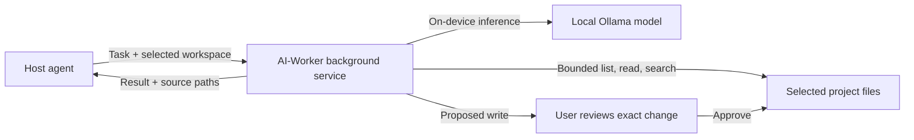

# AI-Worker

[](https://github.com/meharajM/ai-worker-desktop/actions/workflows/ci.yml)
[](./LICENSE)
[](https://github.com/meharajM/ai-worker-desktop/stargazers)

**A local-first desktop subagent for MCP-compatible AI agents.** Hand off a bounded project task to an on-device model, get back a concise result with source paths, and review every proposed file write before it happens.



## What it does

- **Local inference:** MCP task inference uses an on-device Ollama model and never falls back to a cloud model. Apple Silicon development builds also expose an experimental pinned llama.cpp candidate; release installers currently rely on Ollama.
- **Scoped workspace access:** The host passes the active project path and explicitly grants workspace access. Reads are bounded; each file read is limited to 16 KB.
- **Useful handoffs:** Start a task, poll progress, answer a question, cancel work, and receive the result with source paths. Multiple host sessions can use the worker independently.
- **Approved writes:** A proposed file change pauses while AI-Worker shows the target, current contents, and exact proposed contents. No write happens before approval.
- **Optional public research:** Requires both the AI-Worker Settings opt-in and the host's `web` capability. Search terms and requested URLs leave the device; fetched results return to the host.
- **Two interfaces:** Open AI-Worker for the full desktop app. MCP hosts can start or reuse its background service; the compact task window appears during host activity and can sleep when idle.

## Privacy boundary

In **local-only** mode, AI-Worker inference stays on this device, cloud fallback is disabled, and Tauri public research is off. The MCP host still receives the task prompt and completed result; a remote host may process or transmit that text. Use a local host agent too when workspace data must remain on-device end to end.

Model downloads are network activity when you request them. Public research is a separate opt-in. MCP communicates with the app over loopback. AI-Worker's Tauri worker does not provide shell access, browser automation, or connected account services.

## Install when the first desktop release is published

The Tauri release workflow is ready, but this repository does not have a published Tauri installer release yet. Once the first `tauri-v*` release is available, the commands below will install it. Until then, follow **Run from source**.

macOS or Linux:

```sh
curl -fsSL https://raw.githubusercontent.com/meharajM/ai-worker-desktop/main/scripts/install.sh | bash
```

Windows PowerShell:

```powershell
irm https://raw.githubusercontent.com/meharajM/ai-worker-desktop/main/scripts/install.ps1 | iex
```

After that release, download a native installer (`.dmg`, per-user `.exe`, `.AppImage`, or `.deb`) from the [Tauri releases](https://github.com/meharajM/ai-worker-desktop/releases?q=tauri-v&expanded=true). The installer includes the MCP adapter and its Node runtime.

On first launch, install or start Ollama and choose **Set up a local model** if needed, then choose **Connect an AI agent**. Release builds currently use Ollama for local inference. The **Settings → AI Agents** page detects and can add AI-Worker to Codex, Claude Desktop, Claude Code, Cursor, VS Code editor MCP, GitHub Copilot CLI, OpenCode, Gemini CLI, Windsurf, or Cline (CLI or VS Code). Restart the host agent after connecting it. See [Install AI-Worker](./docs/INSTALLATION.md) for platform details.

ChatGPT web requires a remote HTTPS MCP endpoint. The local installer does not create or expose a tunnel.

## Run from source

Requires Node.js 22.12+, Rust, and the platform prerequisites for [Tauri](https://v2.tauri.app/start/prerequisites/).

```sh
git clone https://github.com/meharajM/ai-worker-desktop.git
cd ai-worker-desktop
npm install
npm run tauri:dev
```

Install Ollama and a local completion model if you want to use Ollama. To select a specific installed model for this run:

```sh
AI_WORKER_OLLAMA_MODEL=qwen3-vl:4b npm run tauri:dev
```

`ollama pull qwen3-vl:4b` is an optional model download. AI-Worker does not download Ollama models automatically. If no compatible local runtime is ready, inference reports a recoverable setup error and does not switch to a cloud provider.

## Use an AI agent

After connecting, ask the host agent to call `start_agent_task` with the active project root as `workspaceRoot`, `capabilities:["workspace"]`, and your full request. Ask it to poll `get_agent_task`, relay questions, wait for AI-Worker approval when needed, and return the result with source paths.

The host sends task prompts and results through MCP. AI-Worker runs task inference on-device and pauses proposed writes for desktop approval. If the host itself uses a remote model, it may process the handoff text remotely. The [MCP and host guide](./docs/AI_WORKER_READINESS_MCP.md) covers task behavior and other MCP clients.

Tauri also has a loopback A2A JSON-RPC endpoint. MCP is the documented, tested connection path; see the guide for A2A setup and its current limitations.

## Handoff token benchmark

The checked-in benchmark runs one read-only task against `src-tauri/Cargo.toml`, checks the returned package name and version against the file, then counts the host-facing text before and after handoff with the same local Ollama tokenizer:

```sh
ollama pull gemma3:1b # only if the model is not already installed
AI_WORKER_OLLAMA_MODEL=gemma3:1b npm run tauri:dev
# In another terminal, after the app reports the model ready:
npm run benchmark:handoff
```

### Latest measured result

| Local task (Gemma 3 1B) | Host reads full `src-tauri/Cargo.toml` | Host receives AI-Worker handoff | Estimated context reduction |
| --- | ---: | ---: | ---: |
| Return package name and version | 521 tokens | 183 tokens | **338 tokens (64.9%)** |

Measured on 2026-11-28 with one parent clarification included in the handoff. This is one successful task, not an average across models or repositories. The runner rejects the measurement if the returned package name, version, or source path is wrong.

This estimates only the task prompt and selected-file context. It excludes host system prompts and tool schemas, may differ from the host model's tokenizer, is not a provider-billing estimate, and does not subtract the local inference tokens used by AI-Worker. The benchmark uses the MCP task lifecycle and sends token-count requests only to Ollama at `127.0.0.1`.

## Development

```sh
npm run web:typecheck
npm run web:build
cargo test --locked --manifest-path src-tauri/Cargo.toml
```

See [MCP readiness and host setup](./docs/AI_WORKER_READINESS_MCP.md) and the [docs index](./docs/README.md). The Tauri desktop app is the supported installer path; Electron sources remain in the repository during the migration.

---

If AI-Worker is useful to your workflow, [give the repository a star](https://github.com/meharajM/ai-worker-desktop/stargazers) and share the host/model combination you tested.
