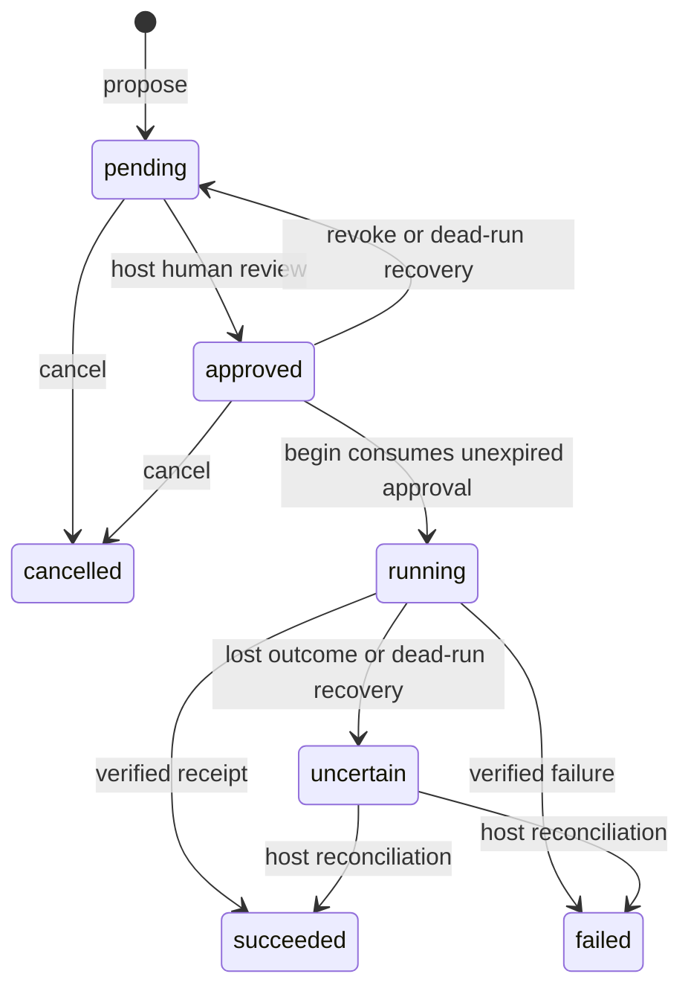

# local-operation-journal

An MIT-licensed embedded SQLite journal for applications that review an operation,
execute it outside the database, and need to recover safely after interruption.
Version 0.1.0 is provisional and has not been published to crates.io.

The crate owns immutable task/proposal records, approval expiry, single-use execution
claims, terminal receipts, and an append-only transition log. The host owns human
authentication, workspace grants, file hashes/backups, command policy, process cleanup,
and reconciliation. It does not provide scheduling, automatic retries, a sandbox,
exactly-once external effects, encryption, or a Temporal/MCP service.

## Package boundary

| Module | Responsibility |
| --- | --- |
| `model` (re-exported) | Framework-independent task, intent, operation, event and outcome DTOs |
| `Journal` | Synchronous SQLite persistence and guarded transitions |
| `bridge` | Versioned JSON proposal/read protocol; no approval/execution authority |
| [TypeScript bridge](../../packages/local-operation-journal-bridge/) | Injected IPC transport with checked responses; zero runtime dependencies |

There are three direct dependencies: rusqlite, serde and serde_json. No Tauri, Tokio,
Node, Python, process, timer or background-thread dependency. The optional `bundled`
feature statically compiles SQLite; it is deliberately off for library consumers.
Enable it in the desktop host for consistent macOS/Windows builds and account for
those native bytes. Otherwise the host must supply a supported system SQLite.
[rusqlite packaging guidance](https://github.com/rusqlite/rusqlite#usage).

## Local use

Add a path dependency in a native host (adjust the path to its manifest):

```toml
[dependencies]
local-operation-journal = { path = "../crates/local-operation-journal", features = ["bundled"] }
serde_json = "1" # for the example payload
```

```rust
use local_operation_journal::{Intent, Journal, NewTask};
use serde_json::json;

fn main() -> Result<(), Box<dyn std::error::Error>> {
// Host creates a private app-data directory first. Never accept this path from IPC.
let mut journal = Journal::open("/private/app-data/operations.sqlite")?;
journal.create_task(NewTask { id: "task-1".into(), title: "Write report".into() })?;
let _operation = journal.propose(Intent {
    id: "proposal-1".into(), task_id: "task-1".into(), kind: "file-write".into(),
    payload: json!({
        "workspace_grant_id": "native-grant-1", "target": "report.md",
        "base": {"expected_absent": true}, "proposed_hash": "sha256:...",
        "staging_reference": "app-owned-immutable-content-1"
    }),
})?;
// Return pending operation to review UI. The library does not validate these file fields.
Ok(())
}
```

IDs are caller-generated unique strings, at most 128 UTF-8 bytes. Task titles are
limited to 512 bytes; JSON intent/receipt values to 64 KiB and depth 64; pages to
100 records. Encode large integers as strings so they survive the JSON/JS boundary.
Do not put credentials in payloads/receipts. Large file bytes, backups and command
output belong in bounded app-owned storage referenced by immutable hashes/IDs.

## Execution and recovery contract



1. Persist intent before displaying its exact review. An existing ID with identical
   content returns its current state; different content returns `Conflict`.
2. After authenticating actual human approval, native code calls
   `approve(id, run_id, ttl)`. TTL is 1 ms–24 hours. Repeating an unexpired approval
   preserves its deadline. Expired approvals require `revoke` and a new review.
3. Immediately revalidate native scope, cancellation, target/base hash, staged
   bytes or executable/argv/cwd/env. Call `begin(id, run_id)` and wait for its
   successful commit **before** performing the effect. Failed/repeated begin
   must not execute anything. Keep host approval revocation and execution serialized.
4. Execute outside the DB transaction. After obtaining a verified result, call
   `finish(id, run_id, Outcome::Succeeded(receipt))` or `Outcome::Failed(receipt)`.
   If outcome is ambiguous, call `mark_uncertain`. If recording the result fails,
   preserve the receipt and reconcile; never repeat the effect to repair a DB error.
5. On restart, first obtain exclusive host ownership and stop/prove absence of
   old owned processes. Each execution lifetime needs a unique run ID. Recover
   each **known dead** run with `recover_run(old_id)`. Opening a connection never
   performs recovery. Running records become `uncertain`; unused approvals become
   `pending`. Other runs remain untouched. Repeated recovery is harmless.
6. Resolve uncertain operations only after inspecting hashes/backups/exit receipts
   or an explicit user decision. `resolve` records that decision. An uncertain or
   completed ID can never be reset for replay. A deliberate retry needs a new
   immutable ID and a fresh review. For CLI effects, do not infer success merely
   because a process is no longer present.

`running` covers the prepared-to-execute boundary, including a crash just before
the external effect. This conservative uncertainty is intentional. File writes and
SQLite commits cannot share one atomic transaction. The library cannot distinguish
“effect never started” from “effect completed but receipt not committed.”

## Durability and host responsibilities

- WAL + `synchronous=FULL`, explicit immediate write transactions and a five-second
  busy timeout. Operation changes and their events commit together. SQLite/OS/disk
  failures still propagate; claims do not override hardware/filesystem guarantees.
  [SQLite sync semantics](https://www.sqlite.org/pragma.html#pragma_synchronous).
- Use an app-owned local disk and a private parent directory. WAL/SHM sidecars are
  part of the database. Do not use network filesystems or copy only the live main
  file for backup; close all connections or use a proper SQLite backup procedure.
  The library resolves parent aliases (such as macOS `/var`) and rejects a symlinked
  final database file; parent permissions and race protection remain host-owned.
- Database identity/schema version reject foreign and newer databases; there is
  no legacy JSON importer or schema downgrade. Existing app data is untouched.
- Calls are synchronous. Move the connection to a host-owned blocking worker with
  a bounded queue. Never run SQLite on the UI thread. A `Journal` is not `Sync`;
  separate connections serialize writes through SQLite. Run identity prevents
  accidental ownership confusion but is not a credential or liveness detector.
- Approval timestamps use the native wall clock. Hosts must enforce their own
  monotonic active-task deadline and grant revocation. Clock rollback can extend
  a wall-clock approval; crash recovery invalidates old unused approvals.
- Records/logs grow with usage. There is no automatic pruning: deleting idempotency
  records can make a reused ID executable again. Add an explicit retention/export
  policy when actual storage measurements justify it.

## TypeScript / Tauri integration

The portable protocol takes/returns JSON strings. A host command accepts one
bounded string, authorizes its window/profile/task scope, validates supported
proposal kinds/fields, then dispatches using a blocking worker:

```rust
// Inside the authorized native worker, with its app-owned journal:
let response_json = local_operation_journal::bridge::dispatch_json(&mut journal, &request_json)?;
```

Reject errors through IPC. Inspect `bridge::Request` before dispatch if your host
needs per-task authorization; `dispatch` accepts that checked typed request.
Do not expose the DB path, SQL or `Journal::approve/begin/finish/resolve/recover_run`
as general renderer/model commands. Human approval belongs to a separate native
review handler bound to the exact immutable proposal. The [TS README](../../packages/local-operation-journal-bridge/README.md)
shows the injected Tauri transport. No Tauri application adapter is wired yet.

## Checks and publication preparation

From this repository root:

```sh
cargo fmt --manifest-path crates/local-operation-journal/Cargo.toml --check
cargo clippy --manifest-path crates/local-operation-journal/Cargo.toml --features bundled --all-targets -- -D warnings
cargo run --manifest-path crates/local-operation-journal/Cargo.toml --features bundled --example recovery
cargo package --manifest-path crates/local-operation-journal/Cargo.toml --features bundled
```

The assert-based example uses a private temporary database. It covers reopening,
immutable-ID conflicts, single-use claims (including two connections racing),
expiry/revocation, dead-run isolation, uncertain reconciliation, atomic transition
logs, protocol tampering, bounds and incompatible database rejection. The TS check
consumes actual Rust-generated fixtures for every bridge method.

Before publication, choose/verify registry names, review API/version compatibility,
run checks on macOS and Windows, record release footprint, and tag both matching
0.1.0 packages. No registry name is reserved. Public API may change before release.
