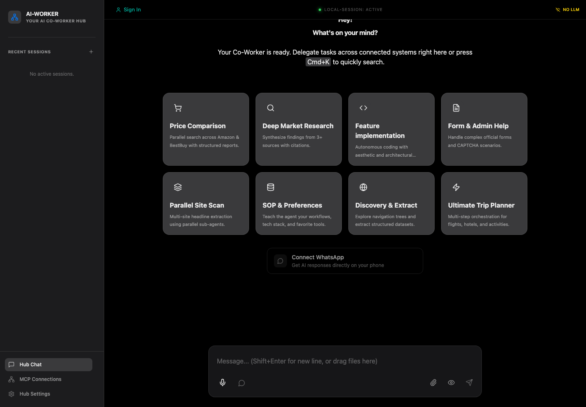
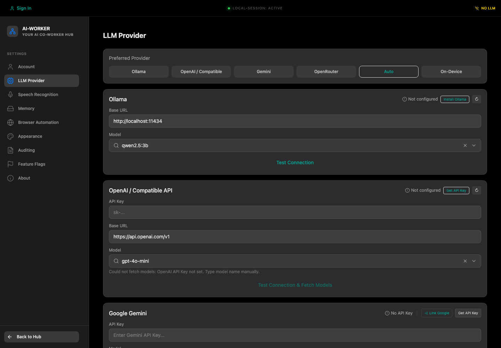
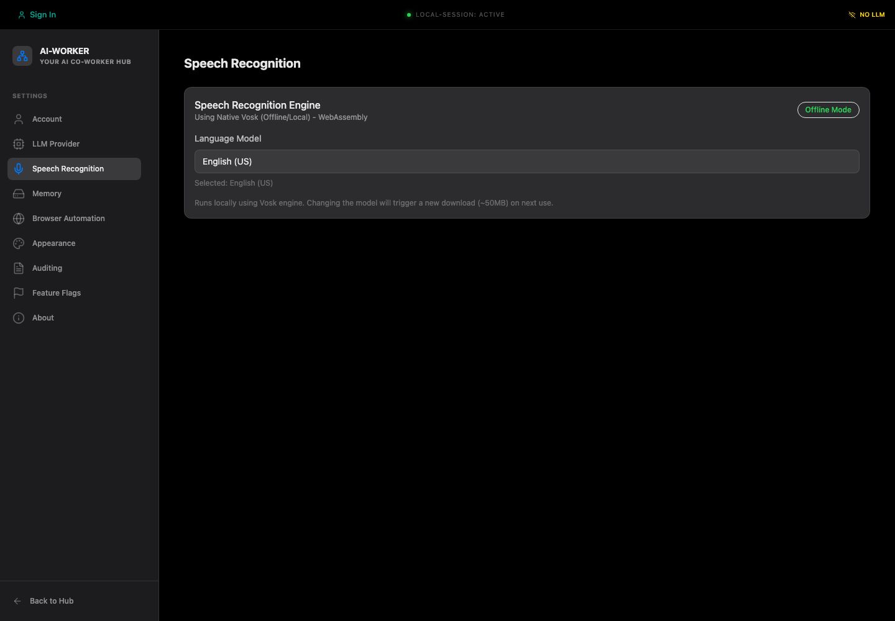
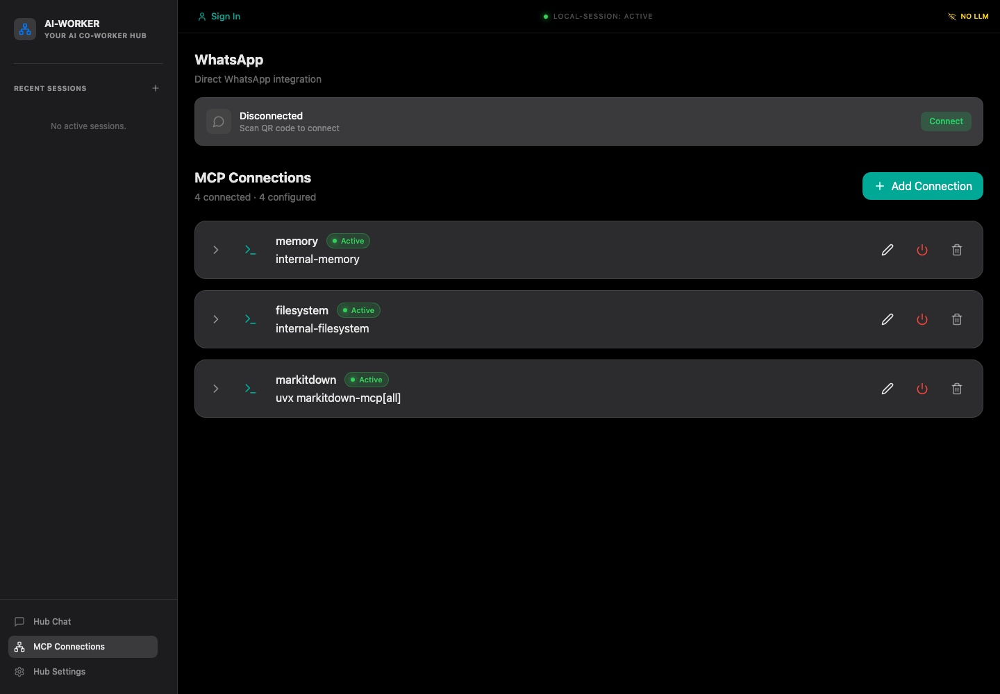

# Development Setup

Current setup targets the Tauri local chat app.

## Prerequisites

- Node.js ≥22.12 and npm
- Rust toolchain
- macOS: Xcode Command Line Tools
- Windows: MSVC C++ build tools and WebView2

The app UI is bundled locally. Tauri's `beforeDevCommand` and `beforeBuildCommand` require `npm run web:build`.

## Install and run

```sh
npm install
npm run tauri:dev
```

Useful commands:

```sh
npm run web:typecheck
npm run web:build
npm run tauri:build
npm run test:rust:chat
npm run test:rust:proof
```

For isolated proof builds use `npm run tauri:proof` and `npm run web:proof-build`. On macOS arm64, `npm run tauri:build:mac:arm64` prepares the pinned llama runtime and builds the app.

## Current app behavior

The current Tauri app is a local chat UI with Assistant UI, LangChain/LangGraph, bounded IndexedDB history, Stop, and native RAM reserve policy. Qwen3 1.7B is a pinned development candidate, not a certified profile. The 3 GiB load estimate and macOS `memory_pressure` heuristic are uncalibrated. One successful real-model run on a 16 GiB Apple Silicon dev Mac is E2E evidence only; packaged app interaction/restart proof, 8 GiB proof, and Windows proof remain open.

Voice, cloud providers, WhatsApp, MCP, filesystem, CLI, and browser tools are not available in this app. Existing setup-dependencies scripts install tools for historical Electron/MCP workflows; they are not prerequisites for current Tauri development.

---

## Historical Electron document retained for migration reference

> The following content is preserved as historical context. Commands and capabilities in it do not apply to the current Tauri app. Use the current sections above for runnable guidance.

# AI-Worker Setup Guide

This guide covers local setup for development, first-run configuration, and the main environment dependencies required by AI-Worker.

## What You Need

- Node.js `>=22.12.0`
- npm
- macOS, Linux, or Windows
- Python 3 and `uv` if you want full MCP document-conversion support
- Docker Desktop only if you plan to build Linux artifacts on macOS
- Wine only if you plan to build Windows artifacts on Linux

## Project Layout

The main entrypoints for local development are:

- `npm run dev` for the desktop app development flow
- `npm run build` for the renderer and Electron bundles
- `npm run lint` and `npm run typecheck` for quality checks
- `scripts/setup-dependencies.sh` or `scripts/setup-dependencies.ps1` for MCP-related system dependencies

## Install Dependencies

From the repository root:

```bash
npm install
```

If you want the helper scripts to install Node.js, Python, and `uv` for you, use:

```bash
./scripts/setup-dependencies.sh
```

On Windows PowerShell:

```powershell
.\scripts\setup-dependencies.ps1
```

More detail on those scripts is available in [scripts/README.md](../scripts/README.md).

## Environment Files

Copy the example environment file if you need local configuration:

```bash
cp .env.example .env
```

Release publishing to Cloudflare R2 uses a separate file:

```bash
cp .env.r2.example .env.r2
```

Only create `.env.r2` if you are handling release publishing.

## Start the App

For normal local development:

```bash
npm run dev
```

This starts:

- the Vite renderer dev server
- the Electron main process
- the Electron preload bundle

If Electron fails to launch, the renderer is typically still available at:

```text
http://localhost:5173
```

## First-Run Experience

When the app is running, you should see the main workspace with:

- a chat-first home screen
- workflow starter tiles
- the bottom message composer
- sidebar navigation for chat, MCP connections, and settings



## Configure Providers

Open `Hub Settings` to configure model providers and speech features.

The `LLM Provider` screen exposes:

- Ollama configuration for local models
- OpenAI-compatible configuration for hosted APIs
- Gemini configuration
- automatic provider selection
- on-device model options where available



Recommended setup paths:

1. Use Ollama if you want local inference.
2. Use OpenAI-compatible settings if you already have a hosted API key.
3. Keep `Auto` selected if you want AI-Worker to choose among configured providers.

## Configure Speech Recognition

Speech recognition is configured from `Hub Settings` -> `Speech Recognition`.

The app currently uses offline/local Vosk speech recognition in the UI shown below.



What to expect:

- speech recognition runs locally
- model choice is language-based
- changing the Vosk model may trigger a new model download on next use

## Configure MCP Connections

Open `MCP Connections` to manage connected tools and services.

AI-Worker ships with default internal services for:

- memory
- filesystem access
- MarkItDown document conversion
- Playwright browser automation

The connections screen also exposes direct WhatsApp integration and custom MCP connection management.



## Optional WhatsApp Setup

If you want phone-based messaging and approvals:

1. Open `MCP Connections`.
2. In the WhatsApp card, click `Connect`.
3. Scan the QR code when prompted.
4. Complete the verification flow inside the dialog.

WhatsApp is optional and not required for core chat or MCP usage.

## Validation Checklist

Use this after setup:

- `npm run lint`
- `npm run typecheck`
- `npm run build`
- `npm run test:mock`

If you want the full mocked end-to-end path:

```bash
npm run test:e2e
```

## Build Commands

Common local build commands:

```bash
npm run build
npm run build:mac
npm run build:linux
npm run build:win
```

If you are packaging manually for Electron, run the shim first:

```bash
npm run prebuild:electron
```

## Troubleshooting

### Electron launches the renderer but the shell crashes

If `npm run dev` starts Vite but Electron throws:

```text
TypeError: Store is not a constructor
```

the renderer may still be usable at `http://localhost:5173` while the main-process issue is being fixed.

### MarkItDown or Python-backed MCP tools do not connect

Make sure Python 3 and `uv` are installed. The helper scripts in `scripts/` handle this for most environments.

### Windows setup script fails

Run PowerShell as Administrator and check execution policy guidance in [scripts/README.md](../scripts/README.md).

### Linux or Windows packaging fails

Check the platform-specific prerequisites:

- Linux builds on macOS require Docker Desktop
- Windows builds on Linux require Wine

## Related Docs

- [Usage Guide](./usage.md)
- [Scripts README](../scripts/README.md)
