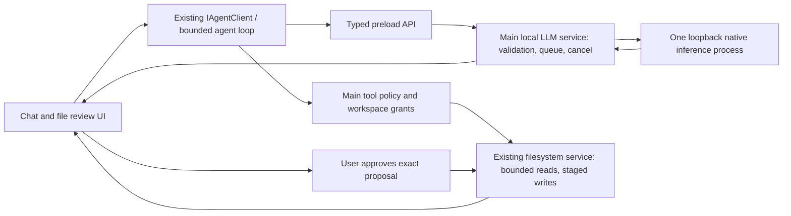

> Archived Electron-first draft. Superseded by the [current Tauri plan](../../local-desktop-product-plan.md). Preserved for rationale/history; do not dispatch these cards.

# AI-Worker Desktop: local assistant product and implementation plan

Status: reviewable planning draft, 10 October 2026. Implementation has not started.

Source requirement: a simple, lightweight, open-source desktop assistant that runs a free model on the user's machine, performs useful tasks within that model's capabilities, and keeps the computer usable.

Implementation repository: `meharajM/ai-worker-desktop`, `main`, starting at `e56f8d2`. Analysis also used the original checkout at `282646e`; the published snapshot contains the credential sanitization from the preceding repository task. Start development from the published repository. Do not push the original checkout's history into it.

The task cards in [luna-implementation-cards.md](./luna-implementation-cards.md) are the execution guide. This document explains product scope, evidence, architecture, dependencies, and release gates. Luna refers to the coding agent executing those cards; the application itself uses a separate local model.

## 1. Product decisions and assumptions

No hardware or initial task preference has been supplied yet. Provisional scope:

- Package for macOS, Windows, and Linux; certify each OS/architecture separately. First hardware measurements: an Apple silicon laptop and a CPU-only Windows/Linux laptop. An unmeasured platform is an experimental build, not a supported performance tier.
- 16 GB RAM is the recommended development and user baseline. 8 GB is a reduced capability tier, subject to available memory; it does not imply every 8 GB machine can load the recommended model.
- First useful tasks: local chat, summarizing selected text files, extracting structured information, and proposing new files or edits for review. Simple multi-step file workflows come after these paths work reliably.
- Browser research is a later opt-in slice. Arbitrary desktop control, terminal execution, messages to other people, autonomous purchases, and unrestricted MCP installations are outside the initial release.
- No account, subscription, cloud inference, telemetry, or API key is needed for core use. Runtime/model acquisition needs internet unless installed artifacts are imported locally. An explicitly requested browser task uses website network access while inference stays local.

Local inference always consumes RAM, CPU/GPU time, battery, and disk. The promise is bounded overhead, visible controls, and graceful refusal when resources are insufficient. It cannot be zero performance impact or frontier-model quality on every laptop.

### User stories

| ID | User outcome |
| --- | --- |
| U1 | Open the app without an account or optional development tools installed. |
| U2 | See a suitable local model recommendation, its download size/license, and a clear setup state. |
| U3 | Chat locally with streaming output and a working Stop button. |
| U4 | Keep the computer usable through resource presets, one active inference, and model unloading. |
| U5 | Grant access to a folder or selected files and ask grounded questions about them. |
| U6 | Review a proposed file change before it is applied, with protection against stale contents and crashes. |
| U7 | Understand which tasks the installed model can reliably perform, including why a task is unavailable. |
| U8 | Install, update, and uninstall without losing chats or personal files. |
| U9 | Later enable bounded browser research with an explicit explanation of website network access. |

## 2. What the code actually provides

These are static findings, not measured performance results. Linked line numbers refer to the inspected baseline and will change during implementation.

| Finding and evidence | Implication | Action |
| --- | --- | --- |
| Electron + React + Zustand already provide the desktop shell and UI; [package.json](../../../package.json). | Replacing the shell would be a substantial port before validating inference. | Keep Electron initially; measure its process footprint before deciding on a native-shell rewrite. |
| `chat()` calls `getAvailableProviders()` before each turn; auto routing can select configured cloud providers. [llm.ts](../../../src/renderer/src/lib/llm.ts#L71), [llm.ts](../../../src/renderer/src/lib/llm.ts#L114). | A provider preference is not an enforced local privacy boundary. Configured cloud providers are checked even when local operation is intended. | Local mode must bypass cloud checks and routing; main-process transport must enforce loopback endpoints and curated local models. |
| Ollama requests use `stream: false` and serialize every message to just `role` and `content`. [ollama.ts](../../../src/renderer/src/lib/llm/ollama.ts#L109). | Slow first visible response; assistant tool calls and named tool results are lost on the next turn. | Implement a native protocol mapping and streaming through a trusted IPC service. |
| Multiple tool calls receive an ID based only on `Date.now()`. [ollama.ts](../../../src/renderer/src/lib/llm/ollama.ts#L143). | Tool calls in one response can collide. | Stable IDs from request identity and call index; preserve the native function identity in subsequent messages. |
| Main-process `llm:chat` is a placeholder. [ipc/llm.ts](../../../src/main/ipc/llm.ts#L3). | The renderer currently owns LLM HTTP transport. | Put HTTP, request ownership, cancellation, and inference scheduling in a main service; keep IPC handlers thin. |
| `ModelManager` downloads Vosk speech archives; `ModelServer` serves them. [ModelManager.ts](../../../src/main/services/ModelManager.ts#L24). | Despite their names, these are not an LLM runtime or GGUF manager. | Keep them out of the inference implementation; voice is deferred. |
| `AgentRuntime` implements `IAgentClient` and has extracted state/tool/orchestration services. [IAgentClient.ts](../../../src/renderer/src/lib/agent/IAgentClient.ts#L43). | A useful existing UI/agent boundary. | Preserve it. Avoid moving the entire agent subsystem or building a second agent framework. |
| The agent uses 50 main / 15 sub-agent iterations and a fixed 100,000-token context threshold. [agent-runtime.ts](../../../src/renderer/src/lib/agent-runtime.ts#L350), [agent-runtime.ts](../../../src/renderer/src/lib/agent-runtime.ts#L1024). | Limits are far above a small-model resource budget. Long tasks may trigger decomposition, delegation, and continuation. | Add a small local task policy and model-specific context budgeting; no automatic sub-agents or continuation in the initial local mode. |
| Memory reflection can run an additional agent when its heuristics trigger. [useAgent.ts](../../../src/renderer/src/hooks/useAgent.ts#L444). | Extra local inference competes with user work; it is conditional, not every chat. | Disable it in the initial local mode; keep chat history and user-saved preferences without reflection. |
| App startup invokes auth/settings sync, WhatsApp bridge, and MCP initialization. [App.tsx](../../../src/renderer/src/App.tsx#L74). | Optional features are coupled to core startup. | Local boot loads chat/settings only; initialize optional services from explicit user actions. |
| Default MCP entries include Playwright, memory, filesystem, and `uvx markitdown-mcp[all]`, with auto-connect enabled. [mcpStore.ts](../../../src/renderer/src/stores/mcpStore.ts#L64). | Fresh installs can start unrelated services or request Python packages. | Default to built-in local file tools only after a workspace grant; optional integrations stay off. |
| Dependency checks mark Node, Python, uv, and Playwright browsers as required. [DependencyService.ts](../../../src/main/services/DependencyService.ts#L33). | Core desktop use is gated by tooling it does not need. | Check dependencies per feature; Electron already supplies the application's Node runtime. |
| File writes are staged by default, with an existing review component. [FileSystemService.ts](../../../src/main/services/FileSystemService.ts#L454), [FileChangeReview.tsx](../../../src/renderer/src/components/FileChangeReview.tsx). | Reusable safety UI and staging logic. | Preserve the review flow and strengthen its main-process enforcement. |
| Path comparison lowercases all platforms and checks lexical paths; commit copies a shadow file over the target. [FileSystemService.ts](../../../src/main/services/FileSystemService.ts#L237), [FileSystemService.ts](../../../src/main/services/FileSystemService.ts#L353). | Case-sensitive roots, symlinks/junctions, path changes between checks, and edits made after staging need handling. Root arguments also need a trusted main-process grant. | Canonicalize permitted roots; validate actual targets; recheck at apply; detect stale base hashes; journal writes. Treat this as a release blocker. |
| `_sessionAutoApprove` is accepted in tool arguments. [FileSystemService.ts](../../../src/main/services/FileSystemService.ts#L448). | Renderer/model arguments must not create approval authority. | Main owns grants and approvals; untrusted arguments cannot bypass review or choose a different workspace root. |
| The main window has `sandbox: false`, `webSecurity: false`, and broad automatic permission grants. [index.ts](../../../src/main/index.ts#L62), [index.ts](../../../src/main/index.ts#L105). | Existing configuration is unsuitable for executing local file actions based on untrusted text. | Restore secure defaults after removing the Vosk/browser-fetch dependency; validate navigation, URLs, and IPC senders. |
| Some regression tests inspect source strings; other E2E tests launch real applications/providers. [regression_critical_checks.cjs](../../../tests/regression_critical_checks.cjs). | Passing a source-substring assertion does not establish behavior or offline operation. | Add focused behavioral tests with a fake local HTTP server and temporary workspaces, then a small offline Electron smoke test. |

### Reuse, disable, then remove

Reuse chat/session UI, `IAgentClient`, existing tool-loop error/duplicate-call protections, electron-store, safeStorage, filesystem staging/review, and existing browser/session cleanup when browser work is introduced.

Disable cloud routing/auth/sync, WebLLM, voice, WhatsApp, background reflection, automatic decomposition, and general MCP autostart in local mode first. Remove their production imports/dependencies only after the core paths pass. Hiding a settings panel alone does not reduce startup work or remove network access.

Keep legacy user data readable during this transition. Do not call `clean:state` or `dev:clean`: these scripts can delete the user's existing application data.

## 3. Runtime and model recommendation

Use **one native Ollama backend for the first implementation**. The integration exists, and its native API supports tool calling and streaming. The first engineering milestone can connect to an already installed local daemon. The consumer release must either manage a complete pinned runtime distribution inside the app or explicitly remain a companion-runtime pilot. Do not label a pilot with an external Ollama prerequisite a finished single-install consumer app.

Keep inference in a separate process. Electron's main process brokers HTTP/OS operations; its event loop must not run inference or synchronously extract multi-gigabyte archives.

Do not add WebLLM as a second default runtime, a multi-provider framework, Python/vLLM, embeddings, or a vector database. If the packaging/performance proof shows that an owned Ollama distribution cannot satisfy release needs, make one reviewed decision to use a native `llama-server` sidecar instead. Do not have Luna implement both engines. Native tool behavior still needs template validation; OpenAI-compatible HTTP alone is insufficient. [llama.cpp tool calling](https://github.com/ggml-org/llama.cpp/blob/master/docs/function-calling.md)

### Initial candidates, not certified defaults

| Hardware tier | Candidate | Intended initial permissions |
| --- | --- | --- |
| 8 GB / limited available memory | Qwen3.5 2B, a verified quantized local artifact | Chat and short extraction; tools disabled until a profile passes task checks. |
| 16 GB / measured headroom | Qwen3.5 4B, a verified quantized local artifact | Bounded file reads, then reviewed write proposals after certification. |
| 32 GB+ / optional quality upgrade | Qwen3.5 9B | Same safety boundary; broader tasks only after measurement. Never an automatic upgrade. |

The official 4B model card specifies Apache-2.0 and documents tool use. This is an open-weight candidate, not proof of reliable task execution in this application. Verify each selected variant's license and provenance. Qwen3.5 supports a non-thinking configuration; use it initially to bound response cost, then verify the pinned runtime honors that setting. [Qwen3.5-4B model card](https://huggingface.co/Qwen/Qwen3.5-4B)

The current Ollama registry lists the 4B variants around 3.3–4.0 GB. Those are artifact sizes, **not RAM requirements**. KV cache, context, backend buffers, multimodal components, and the OS need additional memory. Pin the exact candidate tag, quantization/backend, runtime version, and digest before setup or evaluation; freeze the recommended shipping identity/configuration after measurement and certification. Never use the unqualified `qwen3.5` or `latest` tag for automatic setup: the family page currently associates `latest` with 9B. [Ollama Qwen3.5 registry](https://ollama.com/library/qwen3.5)

If these candidates fail the product checks, compare the text-only Qwen3-4B-Instruct-2507 before changing infrastructure. It is another Apache-2.0 candidate with documented agentic use; its smaller context/output settings still need local measurement. [Official model card](https://huggingface.co/Qwen/Qwen3-4B-Instruct-2507)

Do not adopt the large-model benchmarks shown on a family page as 2B/4B performance claims. Do not download models or benchmark this user's machine as part of this planning task.

## 4. Durable architecture

Keep `IAgentClient` as the UI seam. Keep the agent loop in its existing module for this implementation; move only network transport and OS authority behind IPC. Main must not import renderer types. Put the small transport DTOs in a shared module, and translate existing `LLMMessage` types at the renderer adapter boundary.

### Contracts to settle before editing callers

- **LocalChatRequest**: request ID, session ID, selected model identity, normalized messages, and a bounded set of requested tool schemas. No arbitrary remote URL, shell command, credentials, or renderer-controlled resource limits.
- **LocalChatEvent**: request/session identity plus `queued`, `delta`, `toolCall`, `done`, `error`, or `cancelled`. Usage/timings belong in the terminal event. Separate model thinking from visible answer text; never interpret prose or thinking as an executable tool call.
- **Request ownership**: main associates requests with the trusted sender/window. Cancellation is idempotent and sender-owned. Window destruction removes pending work and event listeners.
- **ModelProfile**: name/tag, expected digest/provenance/license, runtime compatibility, effective context limit, supported modalities, configured thinking mode, and certified task capabilities. Missing/unknown capabilities default to chat only.
- **ResourcePreset**: Low impact / Balanced with context size, output limit, concurrency, idle residency, and tested thread policy. Main resolves these values; the model cannot alter them.
- **TaskPolicy**: allowed tool names, remaining calls, elapsed time, output/context budget, approved workspace grant, and pending proposals. Model suggestions do not grant permissions.
- **WorkspaceGrant**: main-owned ID for a user-selected canonical root or explicit file. Store no arbitrary path supplied by the model as a trusted root.
- **PendingFileChange**: change ID, workspace/session identity, target path, base-content hash or expected absence, proposed-content hash, creation state, and recovery information. Approval binds to the exact proposal and current target state.

Use one application-wide inference queue, initially one active request and at most ten queued requests. Sessions can remain separate while compute is serialized. Preserve assistant `tool_calls` and named tool results when converting to native Ollama messages. Accumulate streamed tool calls before execution and execute only complete validated arguments after the assistant turn finishes. [Ollama native tool protocol](https://docs.ollama.com/capabilities/tool-calling)

### Runtime ownership distinction

For an external daemon, the application can enforce its own queue/request budgets and detect loaded models; it cannot promise global thread limits, reserve all RAM, kill the daemon, or unload work belonging to another client.

For an app-owned process, bind to loopback on an app-controlled port, disable runtime cloud features, and set one loaded model/one parallel request. Server environment changes require restarting that process; they are not per-request knobs. Context and concurrency increase runtime memory, so a large advertised context is not an application default. [Ollama runtime controls](https://docs.ollama.com/faq)

Use request `keep_alive` while a bounded task is running, then expire owned model residency after a short idle interval. Low impact offers immediate unload after the completed task, not between each tool-loop iteration. Only force-stop a process the application owns. [Ollama native API](https://github.com/ollama/ollama/blob/main/docs/api.md)

## 5. Privacy, safety, and persistence rules

1. Local mode is the default and is enforced in main, not just by hidden UI. Allow inference only to approved loopback IP endpoints and installed local model profiles; reject remote/cloud models, redirects, and arbitrary URL overrides. Do not probe old cloud settings.
2. First-run setup may contact approved runtime/model sources only after the user requests setup. Show size/license and a cancelable progress state. No `curl | sh`, npm/uv background installation, or automatic administrator privileges. Do not send prompts/files in download requests.
3. Restore `webSecurity`, context isolation, and sandbox defaults. Deny unnecessary device/location/MIDI permissions. Validate link schemes, top-level navigation, popups, and IPC sender/frame identity.
4. Tools are denied unless capability and task policy both allow them. For v1, allow directory listing, bounded UTF-8 reads, and staging a file proposal. No arbitrary eval, command execution, delete, messaging, or third-party executable installation.
5. File/browser content is untrusted data. Instructions inside it do not expand grants or enable network actions. Enforce this outside the model.
6. Resolve real roots and real existing paths; handle Windows junctions and non-existing write targets by validating the existing parent. Respect platform case rules. Revalidate at read/apply. Symlinks must not escape a grant. Document residual race limits; do not claim complete OS sandboxing from a path-prefix test.
7. Reads have byte/type/count limits before loading data. Start with `.txt`, `.md`, `.json`, and `.csv`; reject binary content and offer a bounded excerpt for oversized input. Avoid recursively ingesting whole workspaces.
8. Writes always require review in initial local mode. Ignore model/renderer approval booleans. Recheck the base hash and target identity, commit via same-directory temporary replacement where supported, and keep recoverable backups/journal entries. If a target changed, show conflict and stage a revised proposal instead of overwriting it.
9. Pending writes survive crashes through a small local journal. Apply is idempotent; recovery never applies a proposal without the user's approval. Undo succeeds only when the file still matches the applied version; preserve newer user edits.
10. Persist chats/settings locally with versioned migration. Bound transient tool-output history; keep full file data out of model context and ordinary logs. Diagnostic export is explicit and redacted. Do not migrate saved cloud credentials into model prompts or new config files.
11. Preserve the published repository's credential sanitization. Use synthetic credentials in tests; keep real keys and original contaminated Git history out of this repository. Review retained screenshots and demo assets before release.

## 6. Initial resource budgets and measurable release targets

All values below are proposed starting budgets or acceptance targets. None has been measured on this project yet. Hardware measurements may justify changing them before release, with recorded evidence.

| Control/target | Low impact starting point | Balanced starting point |
| --- | --- | --- |
| Application inference concurrency | 1 | 1 |
| Active model count for owned runtime | 1 | 1 |
| Context cap | 4,096 tokens | 8,192 tokens |
| Maximum generated output per call | 512 tokens | 1,024 tokens |
| Agent limits | 6 tool calls / 8 model turns / 90 seconds | 8 tool calls / 10 model turns / 120 seconds |
| Consecutive tool/model errors | Stop after 2 | Stop after 2 |
| Duplicate identical tool calls | Stop on third occurrence | Stop on third occurrence |
| Tool response cap | 8 KiB per result, within aggregate context budget | 16 KiB per result, within aggregate context budget |
| Model thinking | Disabled when supported | Disabled initially |
| Owned model idle policy | Unload at task end | Unload after 60 seconds idle |
| CPU threads | Start near half available logical cores, minimum one; measure | Hardware-calibrated value; no claim that thread count caps CPU percentage |

Reserve at least 2 GiB or 25% of installed RAM, whichever is larger, for the OS/user applications when recommending a model. Treat that as an admission heuristic, not a memory guarantee. Recheck pressure during loading/inference; cancel cleanly and offer a smaller model when necessary. Do not silently download/switch models or repeatedly restart on OOM.

Release measurement targets on named supported machines:

- Core app process-tree resident memory at idle, excluding model weights/runtime: target <=400 MiB; idle CPU target <=1% averaged over 60 seconds. Report the actual OS metric rather than treating RSS/PSS/working set as interchangeable.
- No model resident at cold app launch. Chat UI usable within 3 seconds on the reference machines; runtime setup is a separate visible state.
- Stop feedback within 250 ms and no further tools/file proposals after cancellation. Verify server compute stops; target <=2 seconds on the pinned owned runtime, with a bounded escalation path only for an owned hung process.
- Visible UI controls respond within 100 ms during inference. Batch token updates roughly every 50–100 ms instead of writing the entire persisted chat store on every token.
- Provisional warm first-answer-token target <=5 seconds for a short text prompt; record throughput, prompt length, cold-load cost, and backend. No universal tokens/second claim across hardware.
- Record model/runtime peak host memory, GPU/shared-memory use, swap growth, and a simple foreground typing/video-playback check. Do not double-count unified memory or claim OS-wide smoothness from token speed alone.
- No repeated process/model growth after 20 task/cancel/restart cycles. Check process exit, listener disposal, queue cleanup, and staged-file cleanup.
- Offline chat/file tests have zero non-loopback application connections. Model installation and the optional browser mode are tested separately.

Use runtime token usage when available. For preflight context accounting, include system prompt, tool schemas, history, attachments, and reserved output. A character estimate is only conservative admission guidance, especially for Unicode. Preserve whole tool-call/result groups while trimming; do not delete half a protocol turn. If the request cannot fit, ask for a narrower task or excerpt. Do not start another model call merely to summarize every overflowing context.

## 7. Implementation phases

The phase descriptions are stable vertical outcomes. The companion cards provide bounded file-level work packets for Luna; update those anchors if the code moves.

Phases 3–4 are development/evaluation milestones until Phase 5 certifies a profile. Their fake-model and real-model smoke checks use a test-injected candidate capability profile, synthetic files, and temporary user-data/workspace grants. Production profiles remain chat-only until certification; do not hardcode a temporary tool-capability bypass into the application. Workspace, approval, cancellation, and resource enforcement remain active in evaluation.

### Phase 0 — Open a lean local app

Stories: U1, U8. Cards: T00–T07.

Deliver an account-free boot into chat, with versioned local defaults, optional services asleep, per-feature dependency checks, and restored Electron security. Preserve prior chats/settings. Demonstrate launch with internet blocked and without Python/uv/browser bundles.

Acceptance: no auth or optional-service network/process activity; no user-data deletion; existing conversations load; local mode is visible and cannot silently use cloud settings; safe window/IPC defaults hold.

### Phase 1 — Reliable local chat and Stop

Story: U3. Cards: T08–T14.

Deliver an end-to-end local chat path: UI → typed preload → main service → local model → streamed UI. Include native tool-history mapping, request/session identity, complete stream framing, cancellation, timeouts, and one global inference queue.

Acceptance: a deterministic fake server proves framing and errors; an installed local model streams real output; two sessions cannot overlap inference or cross-deliver messages; Stop cancels active/queued work; no cloud fallback on daemon failure.

### Phase 2 — Model setup with resource controls

Stories: U2, U4. Cards: T15–T18.

Deliver a curated model choice and install/setup states, resource presets, measured admission checks, and explicit runtime ownership. Initially support an existing local Ollama installation without making unrelated dependencies mandatory.

Acceptance: cancel/retry setup works; no automatic large-model download; artifact identity/license recorded; low-memory machine gets a smaller recommendation or clear refusal; idle residency follows the policy without killing a shared daemon.

### Phase 3 — Grounded read-only file assistant

Stories: U5, U7. Cards: T19–T24.

Deliver one bounded agent, a small tool set, model-aware context handling, trusted workspace grants, and limited file reads. First demos: summarize one file with source references, compare two selected notes, and extract JSON from a short CSV/text file.

Acceptance: no automatic decomposition/reflection; malicious file instructions cannot escape grants; oversized/binary input stays bounded; unsupported tasks explain the limitation; tool/result identities remain intact throughout a task.

### Phase 4 — Reviewed file changes

Story: U6. Cards: T25–T28.

Deliver a complete proposal → preview → approve/reject → apply/recover path. Start with creating one UTF-8 draft and modifying one existing file. No recursive move/delete or multi-file transaction in this phase.

Acceptance: no original bytes change before approval; no auto-approval argument bypass; edited targets show conflicts; apply/reject/undo survive repeated clicks and crashes; recovery preserves user edits and data.

### Phase 5 — Certify capabilities and performance

Stories: U4, U7. Cards: T29–T30.

Deliver reproducible task/measurement reports for pinned models, configurations, and named hardware. Turn on capabilities from those reports rather than marketing/model-size assumptions.

Acceptance: the task profile meets its quality bar and the chosen hardware passes the resource gates. A failure demotes the capability or marks hardware unsupported; it does not get hidden by retries or cloud fallback.

### Phase 6 — Consumer installation and release

Stories: U1, U2, U8. Cards: T31–T36.

Prove a complete owned-runtime distribution, then ship its lifecycle/packaging, remove unused production dependencies, update setup/repository metadata, and run installation/update/offline checks. Models remain separate, user-requested downloads.

Acceptance: one app installation needs no separate Node/Python/uv or runtime setup for the certified consumer build; native artifacts/licenses are verified; update preserves chats and proposals; resource ownership is clear; all advertised platforms were actually checked. If runtime distribution cannot be validated, label the result as a companion-runtime pilot and resolve that gap before v1.

### Later — Opt-in browser research

Story: U9. Cards: B01–B03, after Phase 5.

Reuse the existing Playwright service lazily. Start with text navigation/extraction in one tab. Website access is explicitly online; page content cannot authorize uploads, purchases, authentication changes, or messages. Screenshot/vision workflows require a separate modality benchmark and memory budget.

## 8. Model capability certification

Build a small synthetic, locally stored suite: 10 short chat/extraction cases, 10 grounded file-read cases, and 10 simple reviewed-write workflows. Include malformed JSON/tool names, Unicode filenames/content, duplicate calls, uncertain requests, context exhaustion, runtime failures, and injected instructions inside files. Use clean temporary workspaces and no real credentials or user documents.

Separate mechanical safety from model quality:

- Tool schemas/protocol: complete valid calls >=98% over the recorded suite; no prose scraping fallback.
- Bounded task completion: proposed promotion bar >=90% for the specific capability profile. Record success counts, retries, elapsed time, and prompt/output tokens. Increase coverage before broad claims; 30 cases are an initial gate, not a general reliability guarantee.
- Grounding: outputs name the actual source file/excerpt; planted unknown facts produce uncertainty rather than fabricated citations.
- Safety: deterministic harness assertions show zero unauthorized writes, network uploads, cross-workspace reads, or ignored cancellation. Passing a model benchmark never replaces these enforcement tests.
- Resource behavior: task completion remains within the selected preset and supported hardware budgets. Bigger contexts/vision do not inherit certification from short text tasks.

Store reports with model digest, runtime version, hardware/OS/backend, prompt fixture revision, config, and result counts. Unknown profiles remain chat only. New runtime/model digests or changes to the certified prompt/template/resource configuration need re-certification; user-triggered upgrades must not silently change capabilities. If performance tuning changes the configuration after T29, rerun the affected capability checks before freezing the shipping catalog.

## 9. Luna execution rules

Use one card per coding turn, with its listed dependencies completed. Default to sequential execution because settings/types/agent files overlap. Do not implement the entire roadmap from one prompt.

Each packet should normally change at most three production files, one focused behavioral test, and a short relevant architecture entry. If work expands beyond the card, split it before adding infrastructure. Do not rewrite modules, add provider abstractions, install an agent framework, or switch Electron/native runtime to solve an unrelated task.

For each packet: read repo/path instructions, read the named symbols and their callers, make the bounded change, run its meaningful checks and typecheck, report actual results/failures, and commit only related files. Use mock runtime/temp data for fast tests; use a real model only in explicitly marked certification work. Do not run destructive data-clean scripts or cloud-dependent test suites by default.

Review especially sensitive boundaries after their packets: IPC ownership, offline enforcement, canonical paths, approval authority/conflict recovery, and owned-runtime cleanup. Luna can implement these packets; release confidence requires a reviewer plus recorded behavioral evidence, not only its self-assessment.

## 10. Recommended next work and unresolved decisions

Start with T00–T07, then the vertical local chat path T08–T14. Do not start UI redesign, many tool integrations, or native-shell migration before that demo passes.

Decisions requiring user/hardware evidence:

1. Which OS/hardware is certified first? This draft covers all three platforms but cannot promise all hardware tiers.
2. Are browser tasks required in the first pilot? If yes, move B01–B03 after the read-only core; their separate network/quality gate remains.
3. What cold-load/warm-response tradeoff is acceptable? Low impact unloads aggressively; Balanced retains a short-lived model.
4. Can the pinned owned Ollama distribution meet installer/lifecycle budgets on each OS? T31 resolves this before adding packaging. A failed proof triggers one runtime decision, not two parallel engine implementations.

No source implementation, model downloads, performance benchmarks, or test execution was performed to produce this plan. The current recommendation is grounded in inspected code and current official documentation; the numerical budgets remain hypotheses until measured.
