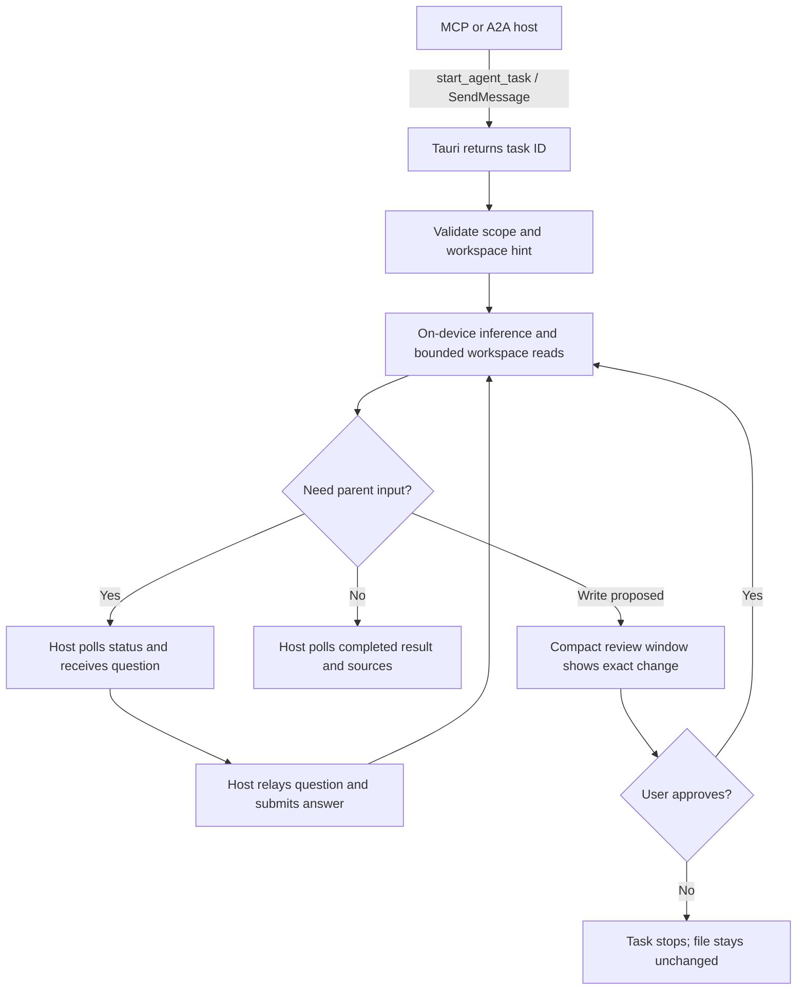

# AI-Worker desktop roadmap

Tauri is the target desktop host. Keep Electron runnable as the current product until Tauri reaches feature parity, passes installed host end-to-end checks, and can import all required user data through a versioned, backed-up, restart-safe migration with a tested rollback. Ship macOS first and verify Windows on its own hardware.

Keep the AI-Worker homepage and its user-visible integrations during the migration, including chat, settings and MCP connections, voice, browser workflows, memory, and WhatsApp. Starting an MCP host starts Tauri in headless worker mode; the compact activity window appears for a host session or task and closes after 20 seconds without active work. Opening AI-Worker normally opens the full app. A worker-only process exits after 30 seconds with no connected hosts, tasks, or main window.

## Task flow

- Accept a bounded task summary, constraints, source agent, active or selected workspace root, working directory when known, and relevant relative file paths. Validate these as hints. Native policy controls OS access. When a task needs workspace access and the host root is missing or unreliable, ask the user to choose one.
- `run_agent_task` stays synchronous and read only; host cancellation is available through the asynchronous task lifecycle only. `start_agent_task` allows bounded reads and searches inside the validated workspace by default. A proposed file write pauses in `waiting_for_approval`; show the handoff context, path, current contents, and exact proposed contents in the compact Tauri window. Apply only the staged proposal after approval and revalidate the target immediately before commit. Decline, dismissal, expiry, cancellation, or stale target state must not write.
- If the delegated agent cannot proceed without a missing fact, expose a structured question through task status and accept the answer only for that pending question as a continuation of the same task. Keep original workspace and capability scope. Task prompts, observations, and results stay in process memory and are lost when AI-Worker exits or restarts; do not claim durable recovery.
- The host polls task status and explicitly retrieves the bounded result and sources after completion. Disclose that the configured MCP host may be remote and can process or forward returned questions and results.
- Cancellation is cooperative. A task may remain `cancelling` while an in-progress local model generation finishes; report cancellation only after the worker has stopped.
- Use on-device inference for delegated work in Local-only and Connected modes. Local-only must never fall back to cloud. Reuse a loaded WebLLM model or an installed model in loopback Ollama where compatible. Keep public web research and connected services separately scoped and disclosed in Connected mode. Use only operations already supported by live connections.
- Keep the operation journal standalone for future write recovery. Claim journal-backed recovery only after desktop host integration and crash tests pass. [Journal integration cards](./operation-journal-integration.md)

## Stages and acceptance gates

| Stage | Work and gate |
| --- | --- |
| 1. Tauri host, lifecycle, and discovery | Establish discoverable local MCP and A2A endpoints and carry them across normal window open and close. Verify duplicate launch, idle operation, restart, and explicit quit. Clean up owned processes and discovery state. |
| 2. On-device status and inference | Expose truthful app and model readiness. Verify a real response, cancellation, and the next request with a loaded WebLLM model or an installed model in loopback Ollama on the target platform. A missing model prompts setup and never triggers cloud fallback. Consider the unfinished `llama-server` candidate only after measured compatibility, cancellation, and resource checks. |
| 3. Host handoff and workspace reads | Pass bounded context into native validation. Verify correct worktree and relative-file handling, user selection for an unreliable root, rejection of workspace escapes, and read and search limits. |
| 4. Compact review, writes, and result return | Tauri stages async workspace writes for exact-content review. Verify rejection, cancellation, expiration, stale files, and question/answer continuation retain only the original task scope. Keep interrupted writes out of automatic replay. Optional public web research is implemented behind both Settings opt-in and a host task capability; it has not been live tested. Connected-service actions remain unavailable in Tauri. |
| 5. Homepage parity and user data | Verify existing homepage workflows and integrations on Tauri. Validate import, restart, repeat import, interrupted import, and rollback using representative Electron profiles. Keep Electron and the original profiles usable throughout. |
| 6. Installed hosts and packaging | Install/register the MCP server and subagent instructions with supported hosts; verify A2A discovery and JSON-RPC interoperability with an A2A client. Run installed Codex and OpenCode against packaged Tauri builds on each supported platform. Verify background discovery, local inference, bounded reads, question/answer continuation, automatic result return, write review, update, and rollback. Record platform and WebView evidence. |
| 7. Electron retirement | Remove Electron only after stages 1–6 pass, feature parity is demonstrated, and all required data can be safely imported and rolled back. Preserve user backups and the supported migration path. |

## User-data migration

Electron and Tauri have different app IDs and storage origins. Export logical records from Electron and validate them before Tauri import. Never copy Chromium LevelDB directly. The user-selected Electron JSON archive remains the source backup. Tauri chat import adds records under deterministic content-derived IDs, preserves existing chats, and can remove only sessions represented by the same validated archive. Tauri memory import keeps an exact local archive backup and a transactionally recorded migration receipt before adding graph records.

Current storage inventory, checked 2026-11-27:

- Electron stores chat sessions and messages in `ai-worker-chat-v3` in renderer localStorage. Settings, MCP configuration and secrets live in separate stores; local memory, browser profiles, WhatsApp pairing, logs and workspace task files have additional paths.
- Tauri chat now uses bounded IndexedDB sessions (up to 50 sessions and 512 turns), with a Recent chats list and session switching. The previous WebView key (`ai-worker.local-chat.v1`) is imported idempotently on first open and left untouched as a local backup. Setup preferences remain in `app_data_dir()/preferences.json`, model files under `app_data_dir()/models`, and imported memory in `app_data_dir()/memory/graph.sqlite3` with private local file permissions. Tauri supports dark, light, and system theme preferences; older preference files default to dark. Tauri still has no persisted selected-workspace list. External tasks and approvals are in process memory.
- The active Tauri entry loads a reduced `LocalApp`; it does not load the Electron homepage. Keep Electron and its original profiles as the rollback path until parity, export/import, and rollback are demonstrated.
- Electron has an explicit JSON export for up to 50 chats and 512 turns with allowlisted appearance/speech preferences and a stable content-derived migration ID. Tauri Settings now accepts that file, verifies its allowlist, limits, and SHA-256 content ID, previews counts, and imports chats additively with deterministic session/turn IDs. Repeat import is idempotent. A second-step rollback removes only the matching imported sessions (including any later turns in those sessions) and leaves the source file unchanged. The importer validates but does not apply exported theme or speech settings; Tauri theme is set separately in Settings. It does not migrate credentials, workspace paths/grants, approval settings, tool records, attachments, MCP config, browser profiles, WhatsApp pairing, or logs. Memory moves through the separate versioned archive flow below.

- Preserve chat and history, non-secret settings and MCP configuration, memory JSONL and SQLite records, and per-workspace task state. Decide explicitly which drafts, logs, and browser profile data to import or retain in backup. Pending drafts stay unapproved.
- Keep OS-protected secrets, workspace grants, approvals, and ephemeral MCP tokens out of automatic migration. Require reauthorization or credential entry in Tauri. Decide how to preserve WhatsApp pairing continuity through an explicit secure transfer or re-pair flow.
- Complete memory export now reads the full server-memory graph, independent of the partial cache. Tauri validates the selected archive before preview, saves the exact archive atomically before import, and imports entities, relations, and its content-derived receipt in one SQLite transaction. Repeat import is idempotent across restart; imports are additive and never delete unrelated rows. Add a reviewed rollback/restore path and test process interruption before treating memory migration as cutover-ready. [M08 export](./luna-implementation-cards.md#m08--add-a-versioned-legacy-electron-export) · [M09 import](./luna-implementation-cards.md#m09--importexport-safely-in-tauri) · [M37 rollback](./luna-implementation-cards.md#m37--prove-update-recovery-and-rollback) · [M39 retirement](./luna-implementation-cards.md#m39--remove-electron-production-and-build-paths)

## Verified implementation status — 2026-11-27

### Latest real-host recheck of `358a60e`

- OpenCode 1.17.18 connects to the AI-Worker MCP server, but its local Qwen parent did not invoke a task. Codex CLI invoked the MCP status and async task lifecycle and answered an AI-Worker parent question; the task completed with a generic response that did not include the requested package metadata. Codex used its configured remote model, so the host processed the prompt, workspace path, and returned text.
- A later process inspection found that the shared Tauri listener was an older executable than the checkout; its subsequent local-only snapshot reported `model.available=false`. That readiness value was not observed during the completed Codex call. No current-HEAD runtime test was run; restarting the shared worker could interrupt existing host sessions. Use a ready local model and an isolated app profile or an approved idle window for the next real host test.
- These checks confirm host connection and task lifecycle, but do not pass result-quality verification or prove current-HEAD runtime behavior. See the earlier source-built and packaged tests below for their separate scope.

- A source-built Tauri instance ran under a separate test identifier, leaving the installed app and its data untouched. The native bridge published an authenticated loopback endpoint in `local-only` mode.
- A real stdio MCP client discovered all seven tools. `get_runtime_status` reported local-only operation; after loading the installed `qwen3-vl:4b`, `ask_local` returned `pong`. The asynchronous task flow read `src-tauri/Cargo.toml` and returned `ai-worker-tauri 0.1.2` with that relative source. The legacy synchronous `run_agent_task` also returned the same package metadata. A real cancellation returned `cancelling`, then `cancelled`.
- The live model did not complete a parent-question round trip: a cold-model task timed out, and a second prompt intended to request clarification failed before publishing a question. Rust tests cover the exact question/answer/resume flow, but model-driven clarification still needs a reliable local-model check.
- OpenCode 1.17.18 reports `ai_worker_readonly` connected to the live Tauri bridge. Its local `qwen3-vl:4b` parent did not issue a tool call within a two-minute run. Attempting to select the named subagent as the primary agent falls back to OpenCode's default agent, so host-driven OpenCode delegation remains unverified. OpenCode may make separate startup/update network requests; AI-Worker's local bridge does not control host networking.
- A packaged macOS Tauri app was rebuilt with the current frontend in a temporary output directory and a test-only bundle ID. Its bundled MCP server started and exposed all seven tools. With installed `gemma3:4b` selected locally, an async workspace task reached `waiting_for_approval`; the compact window showed task context, selected workspace, current text, and exact proposed text. Approving it completed the task and changed only the temporary test file. A separate dismissal left its test file unchanged. The installed AI-Worker app and its data were not touched. `qwen3-vl:4b` returned `pong` through `ask_local`, but its task-planner request produced only hidden thinking and no final text; choose and verify a compatible installed model for planner tasks. Tauri detects system memory, CPU, architecture, and estimated model-storage space, recommends a Qwen3 size, and starts a cancellable Ollama pull in a background worker when Ollama is running without a usable local model. The profiles are conservative heuristics, not certified performance thresholds; the flow still requires Ollama to be installed and running.
- Current-pass Codex CLI check: the first model-driven workspace handoff failed with an invalid planner action. A single bounded corrective retry was added while strict action validation remains in place. A subsequent Codex CLI run called `get_runtime_status`, started an asynchronous task with the exact repo root and handoff context, polled it to completion, and returned `ai-worker-tauri 0.1.2` from `src-tauri/Cargo.toml`; the Activity window showed `Completed` and `Codex · MCP`. The initial status call saw `modelReady=null` and stale metadata before inference; after the successful task, the owner-protected snapshot reported `model.available=true` with a fresh heartbeat. This tested read-only workspace handoff only. The Codex host used its configured remote model, so the task prompt, selected path, and returned metadata were visible to that host; AI-Worker inference remained local-only. OpenCode 1.17.18 lists both project profiles and reports the read-only MCP server connected, but its local Qwen parent produced no tool call in a roughly three-minute run. Host-driven OpenCode delegation remains unverified.
- Current-pass verification: the rebuilt debug Tauri app launched, its main window reopened from Finder, and the native bridge reported ready. The compact Activity window displayed the completed Codex task. The prior local-chat transcript still shows `LOCAL_CHAT_OK` under an earlier `qwen3-vl:4b` message; a fresh chat generation was not tested in this repeat. Rust tests passed (89 passed, 1 ignored), the focused Node suite passed (36/36), `npm run web:typecheck`, `npm run web:build`, `cargo fmt --check`, `git diff --check`, and `npx tauri build --debug --no-sign --bundles app` passed. Optional web research is implemented behind its mode gate; disclosures explain that search terms and public URL paths/query are sent to the selected search service. No live web-research or connected-service action was performed in this pass.
- Current checks: Electron `npm run typecheck` and `npm run build`; Tauri `npm run web:typecheck`, `npm run web:build`, maintained `npm run test:tauri:import`, `node --test tests/desktop-bridge.test.mjs`, and the focused Rust preference tests pass. The saved dark/light/system preference now applies across the main, Activity, and Write Approval Tauri windows. The isolated Playwright flow imports two synthetic archives, repeats import without duplicate records, renders/reloads the IndexedDB chat, rejects a multibyte title above the storage byte limit before writing, and rolls back one archive while preserving an unrelated chat. It uses a fresh browser context, not an installed app profile or real user export. Cross-window native theme rendering, the native Tauri file picker, and process termination during an in-progress multi-session import were not exercised.
- Tasks remain process-memory only; closing the main window hides the app to the tray, and quitting the process stops the bridge. macOS Finder/Dock reopen now restores the main window when no window is visible. Electron still owns separate chat, memory, credential, browser-profile, and connected-service data. Chat export/import has bounded validation, deterministic retry IDs, additive writes, and archive-scoped rollback. Tauri memory now has a private SQLite store and an explicit archive import with a retained exact backup and transaction-safe idempotency; memory search is not yet connected to chat or task planning, and memory rollback/interruption recovery remain open. Applying exported preferences remains incomplete. A 2026-11-27 source audit removed the disabled, unregistered Antigravity OAuth/gateway implementation; its persisted credential files were left untouched. Tauri still runs a reduced `LocalApp` UI, so Electron remains the full application runtime. Account/workspace migration, installed-host delegation, feature parity, and Electron retirement remain incomplete or unverified.

Keep Electron available until the later parity, installed-host, migration, and rollback gates pass. [MCP bridge and host setup](../docs/AI_WORKER_READINESS_MCP.md) · [Migration baseline](./reports/migration-baseline.md) · [Stack proof](./reports/stack-proof.md)

- Memory migration phase: Electron export reads and sorts the full `read_graph` response, validates shape and references, and emits a versioned 64 MiB archive whose digest stays stable across export timestamps. Tauri Settings previews it, imports only after a click, stores SQLite data in `app_data_dir()/memory/graph.sqlite3`, and retains an exact archive backup in `app_data_dir()/memory-archives/` before the transaction. SQLite import validates digest, IDs, references, and limits; uses an atomic transaction and backend-scoped restart-safe receipts; preserves unrelated rows; and uses FTS5 when available. A shared archive fixture is generated by the frontend serializer, compared byte-for-byte in Node, then imported by Rust; backup tests verify private file modes and reject symlink backups. Checks: full Rust suite (102 passed, 1 ignored), TypeScript checks, 39 bridge/export tests, isolated mocked-bridge Playwright memory-import E2E, and existing chat-import E2E all pass. Unix directory-entry sync is checked before import; Windows syncs the backup file before rename and still needs native durability verification. No real user archive or installed profile was used. Native Tauri window/file-picker interaction and live Electron memory-server export remain untested; current server-memory archives have empty entity/relation metadata, and the persisted store is not yet connected to agent memory retrieval or rollback.
