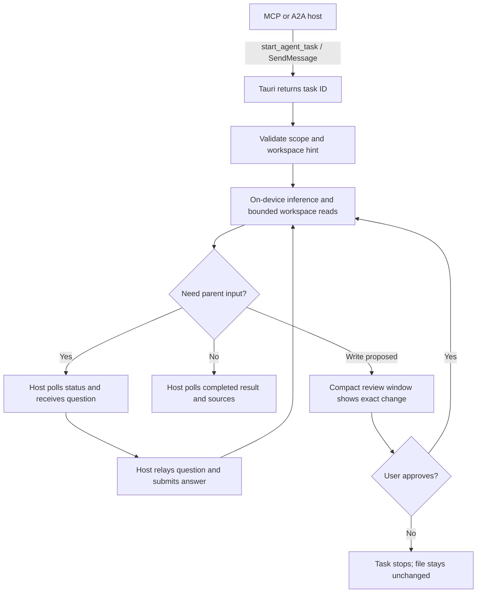

# AI-Worker desktop roadmap

Tauri is the target desktop host. Keep Electron runnable as the current product until Tauri reaches feature parity, passes installed host end-to-end checks, and can import all required user data through a versioned, backed-up, restart-safe migration with a tested rollback. Ship macOS first and verify Windows on its own hardware.

Keep the AI-Worker homepage and its user-visible integrations during the migration, including chat, settings and MCP connections, voice, browser workflows, memory, and WhatsApp. Add a compact task and review window that opens only for an external-agent task or approval. The service stays available in the background when windows close.

## Task flow

- Accept a bounded task summary, constraints, source agent, active or selected workspace root, working directory when known, and relevant relative file paths. Validate these as hints. Native policy controls OS access. When a task needs workspace access and the host root is missing or unreliable, ask the user to choose one.
- `run_agent_task` stays synchronous and read only. `start_agent_task` allows bounded reads and searches inside the validated workspace by default. A proposed file write pauses in `waiting_for_approval`; show the handoff context, path, current contents, and exact proposed contents in the compact Tauri window. Apply only the staged proposal after approval and revalidate the target immediately before commit. Decline, dismissal, expiry, cancellation, or stale target state must not write.
- If the delegated agent cannot proceed without a missing fact, expose a structured question through task status and accept the answer only for that pending question as a continuation of the same task. Keep original workspace and capability scope. Task prompts, observations, and results stay in process memory and are lost when AI-Worker exits or restarts; do not claim durable recovery.
- The host polls task status and explicitly retrieves the bounded result and sources after completion. Disclose that the configured MCP host may be remote and can process or forward returned questions and results.
- Cancellation is cooperative. A task may remain `cancelling` while an in-progress local model generation finishes; report cancellation only after the worker has stopped.
- Use on-device inference for delegated work in Local-only and Connected modes. Local-only must never fall back to cloud. Reuse a loaded WebLLM model or an installed model in loopback Ollama where compatible. Keep public web research and connected services separately scoped and disclosed in Connected mode. Use only operations already supported by live connections.
- Keep the operation journal standalone for future write recovery. Claim journal-backed recovery only after desktop host integration and crash tests pass. [Journal integration cards](./operation-journal-integration.md)

## Stages and acceptance gates

| Stage | Work and gate |
| --- | --- |
| 1. Tauri host, lifecycle, and discovery | Establish discoverable local MCP and A2A endpoints and carry them across normal window open and close. Verify duplicate launch, idle operation, restart, and explicit quit. Clean up owned processes and discovery state. |
| 2. On-device status and inference | Expose truthful app and model readiness. Verify a real response, cancellation, and the next request with a loaded WebLLM model or an installed model in loopback Ollama on the target platform. A missing model prompts setup and never triggers cloud fallback. Consider the unfinished `llama-server` candidate only after measured compatibility, cancellation, and resource checks. |
| 3. Host handoff and workspace reads | Pass bounded context into native validation. Verify correct worktree and relative-file handling, user selection for an unreliable root, rejection of workspace escapes, and read and search limits. |
| 4. Compact review, writes, and result return | Tauri now stages async workspace writes for exact-content review. Verify rejection, cancellation, expiration, stale files, and question/answer continuation retain only the original task scope. Keep interrupted writes out of automatic replay. Web and connected-service tools remain unimplemented in Tauri. |
| 5. Homepage parity and user data | Verify existing homepage workflows and integrations on Tauri. Validate import, restart, repeat import, interrupted import, and rollback using representative Electron profiles. Keep Electron and the original profiles usable throughout. |
| 6. Installed hosts and packaging | Install/register the MCP server and subagent instructions with supported hosts; verify A2A discovery and JSON-RPC interoperability with an A2A client. Run installed Codex and OpenCode against packaged Tauri builds on each supported platform. Verify background discovery, local inference, bounded reads, question/answer continuation, automatic result return, write review, update, and rollback. Record platform and WebView evidence. |
| 7. Electron retirement | Remove Electron only after stages 1–6 pass, feature parity is demonstrated, and all required data can be safely imported and rolled back. Preserve user backups and the supported migration path. |

## User-data migration

Electron and Tauri have different app IDs and storage origins. Export logical records from Electron and validate them before Tauri import. Never copy Chromium LevelDB directly. Back up both sides before applying changes. Keep a versioned import record so restarts and retries cannot duplicate or silently drop data.

- Preserve chat and history, non-secret settings and MCP configuration, memory JSONL and SQLite records, and per-workspace task state. Decide explicitly which drafts, logs, and browser profile data to import or retain in backup. Pending drafts stay unapproved.
- Keep OS-protected secrets, workspace grants, approvals, and ephemeral MCP tokens out of automatic migration. Require reauthorization or credential entry in Tauri. Decide how to preserve WhatsApp pairing continuity through an explicit secure transfer or re-pair flow.
- Verify complete memory export with only part of the cache loaded. Fix the SQLite migration's restart safety and verify interruption, repeat import, and rollback before cutover. [M08 export](./luna-implementation-cards.md#m08--add-a-versioned-legacy-electron-export) · [M09 import](./luna-implementation-cards.md#m09--importexport-safely-in-tauri) · [M37 rollback](./luna-implementation-cards.md#m37--prove-update-recovery-and-rollback) · [M39 retirement](./luna-implementation-cards.md#m39--remove-electron-production-and-build-paths)

## Verified implementation status — 2026-11-27

- A source-built Tauri instance ran under a separate test identifier, leaving the installed app and its data untouched. The native bridge published an authenticated loopback endpoint in `local-only` mode.
- A real stdio MCP client discovered all seven tools. `get_runtime_status` reported local-only operation; after loading the installed `qwen3-vl:4b`, `ask_local` returned `pong`. The asynchronous task flow read `src-tauri/Cargo.toml` and returned `ai-worker-tauri 0.1.2` with that relative source. The legacy synchronous `run_agent_task` also returned the same package metadata. A real cancellation returned `cancelling`, then `cancelled`.
- The live model did not complete a parent-question round trip: a cold-model task timed out, and a second prompt intended to request clarification failed before publishing a question. Rust tests cover the exact question/answer/resume flow, but model-driven clarification still needs a reliable local-model check.
- OpenCode 1.17.18 reports `ai_worker_readonly` connected to the live Tauri bridge. Its local `qwen3-vl:4b` parent did not issue a tool call within a two-minute run. Attempting to select the named subagent as the primary agent falls back to OpenCode's default agent, so host-driven OpenCode delegation remains unverified. OpenCode may make separate startup/update network requests; AI-Worker's local bridge does not control host networking.
- Rust tests pass (50 passed, 1 existing ignored). Focused MCP/host/profile tests pass (9 passed), and critical regression checks pass. These verify code and the direct live bridge, not installed-app migration or write approvals.
- A packaged macOS Tauri app was rebuilt with the current frontend in a temporary output directory and a test-only bundle ID. Its bundled MCP server started and exposed all seven tools. With installed `gemma3:4b` selected locally, an async workspace task reached `waiting_for_approval`; the compact window showed task context, selected workspace, current text, and exact proposed text. Approving it completed the task and changed only the temporary test file. A separate dismissal left its test file unchanged. The installed AI-Worker app and its data were not touched. `qwen3-vl:4b` returned `pong` through `ask_local`, but its task-planner request produced only hidden thinking and no final text; choose and verify a compatible installed model for planner tasks. Tauri now detects system memory, CPU, architecture, and estimated model-storage space, recommends a Qwen3 size, and starts a cancellable Ollama pull in a background worker when Ollama is running without a usable local model. The profiles are conservative heuristics, not certified performance thresholds; the flow still requires Ollama to be installed and running. `LocalApp.tsx` still lacks a working chat-send path. Tauri internet research, connected-service actions, user-data migration, installed Codex/OpenCode handoff, crash recovery, and Electron retirement remain unimplemented or unverified.

Keep Electron available until the later parity, installed-host, migration, and rollback gates pass. [MCP bridge and host setup](../docs/AI_WORKER_READINESS_MCP.md) · [Migration baseline](./reports/migration-baseline.md) · [Stack proof](./reports/stack-proof.md)
