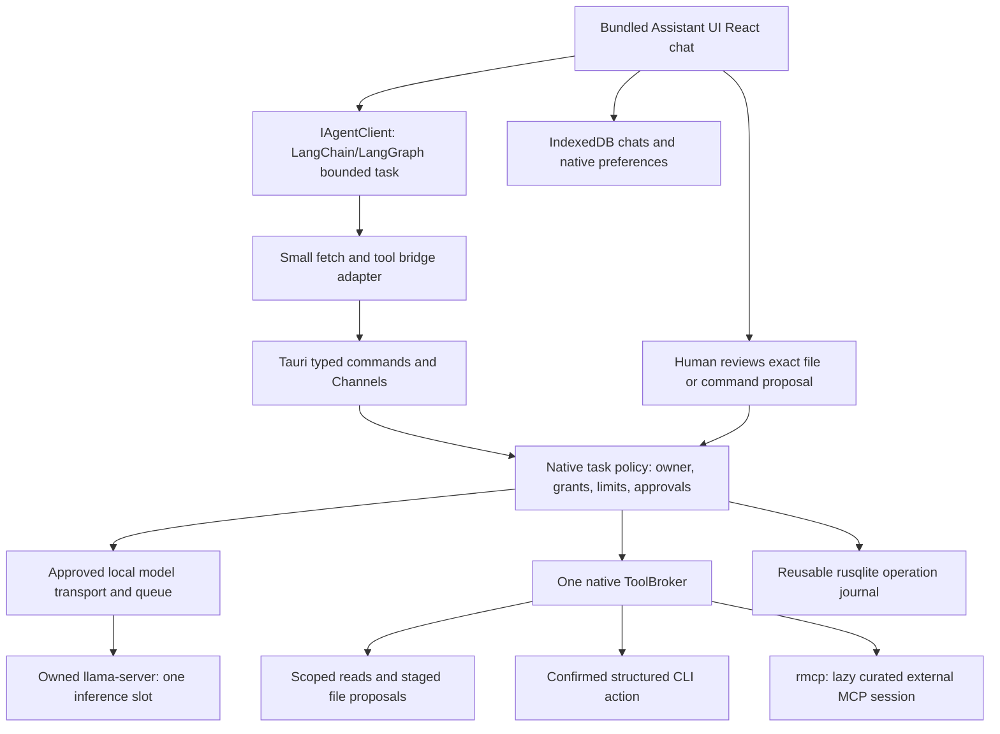

# AI-Worker Desktop: small Tauri bridge and offline web UI

Revision 7, 11 October 2026. Product is a local offline Tauri chat app, macOS first and Windows next. M15 Assistant UI, bounded IndexedDB history and Stop are complete (`b803854`, `c38d02d`, `50803e0`); M16a resource policy is complete (`1719c04`) and all 21 browser proof checks pass after the flushSync harness fix. Scripts/CI updated (`46ac0b8`, `2200280`). One real UI→graph→native→model→UI response succeeded on a 16 GiB Apple Silicon development Mac; this is one-run E2E evidence, not repeatable/certified profile evidence. Packaged-app interaction/restart proof remains unverified. The pinned Qwen3 1.7B development candidate uses an uncalibrated 3 GiB peak estimate and macOS memory-pressure heuristic. 8 GiB and Windows evidence remain open.

Repository: `meharajM/ai-worker-desktop`, clean published baseline `e56f8d2`. Do not bring the original `ai-worker.app` history into this repository. Keep its published credential sanitization.

The user's latest direction supersedes the Electron-first recommendation. Preserve the [previous plan](./archive/electron-v1/local-desktop-product-plan.md) for history, but execute only the [current Luna cards](./luna-implementation-cards.md). The [chat-first plan](./chat-first-delivery.md#final-goal) defines the final product goal, 16 GiB macOS beta and full M41 release. The [custom-code audit](./custom-code-alternatives-audit.md) records replacement choices, code evidence, current source links, licenses and unmeasured limits.

## 1. Confirmed requirements

- A local web interface packaged/served by Tauri, usable offline after prerequisites and model setup. Use bundled assets and Tauri's asset protocol; no production Vite/Node/HTTP UI server.
- Keep the native application small. Reuse libraries, mature CLIs and maintained MCP servers where they provide actual functionality; avoid porting the entire Electron main layer into another sidecar.
- macOS first, Windows next. The last answer supersedes Linux-first. Initial candidate architectures: macOS Apple silicon and Windows x64; Intel Mac/Windows ARM/Linux need separate evidence before support claims.
- File operations within a user-selected scope. Writes need exact proposal review. CLI execution requires confirmation of the command and its workspace.
- Free local model and open-source application/dependencies. Inference remains local; optional browsing explicitly uses website network access.
- Keep the machine usable through bounded work. Footprint accounting excludes inference only as a separate category, while still reporting total resource use.

### Full-release scope

Chat, selected text-file summarization/comparison/extraction, reviewed creation/edit of one file, confirmed registered CLI actions, and a small curated MCP integration mechanism. UTF-8 text/Markdown/JSON/CSV first. Browser research and office/PDF conversion are optional later integrations.

M16c is an earlier reviewable macOS Apple silicon chat-only beta for a physically certified 16 GiB profile. It includes explicit model setup, real Stop, legacy chat migration, offline clean-install and footprint evidence. It grants no workspace, CLI or MCP tools. The full consumer release remains M41; 8 GiB and Windows support require their own hardware proof.

No account, cloud inference, telemetry, voice, WhatsApp, automatic sub-agents, vector memory, unrestricted shell/desktop control, or marketplace autoinstall in this release. CLI initially exposes registered structured actions; users see each action before execution. A workspace cwd is not an OS sandbox, so arbitrary scripts/project execution must not be described as confined file operations.

## 2. Durable decisions

| Area | Decision | Why |
| --- | --- | --- |
| UI | Use Assistant UI's React chat runtime/components over the existing React/Vite/Tailwind static app, with one custom adapter to `IAgentClient`. | Reuses the current web stack and provides streaming chat interactions. LangChain/LangGraph remain the AI layer; bounded IndexedDB remains the only durable chat history. Measure the complete UI bundle against the 750 KiB gzip target before promotion. |
| Desktop | Tauri 2 + system WebView, one main window. | Removes the bundled Electron/Chromium/Node distribution. OS WebView costs remain visible. [Tauri process model](https://tauri.app/concept/process-model/) |
| Native bridge | Rust owns capabilities, workspace grants, approvals, local HTTP, process lifecycle and resource/task limits. | Browser/model input cannot create OS authority. Keep commands thin and domain modules small. |
| Agent mechanics | LangChain.js provider/message types and an explicit bounded LangGraph.js graph behind existing `IAgentClient`. | Replaces custom streaming and tool-loop mechanics while retaining the UI seam; the first chat graph has no tools. M19b connects read tools through native ToolBroker. [Migration decision](./langchain-langgraph-migration.md) |
| Inference | One owned pinned `llama-server` process and an exact GGUF/template profile, started lazily. | Direct native sidecar supports a small bridge without a bundled Node/Python server or parallel engine implementations. Actual size/reliability need proof. [llama.cpp](https://github.com/ggml-org/llama.cpp) |
| Tools | One native ToolBroker with built-in workspace policy, mature CLI actions, and official `rmcp` for external servers. | In-process library use avoids extra processes; real external MCP sessions use a maintained protocol library. [Rust SDK](https://github.com/modelcontextprotocol/rust-sdk) |
| Persistence | IndexedDB for bounded chat/history; official Tauri store for fixed preferences; `local-operation-journal` for immutable task/operation proposals, approvals and recovery. | Reusable synchronous rusqlite crate plus portable TypeScript bridge, with no workflow server. [Journal contract](../crates/local-operation-journal/README.md), [Tauri store](https://tauri.app/plugin/store/) |
| Optional browser | Official Microsoft Playwright MCP, explicitly enabled and pinned. | Replaces custom browser handlers; Node/browser costs are separate and never required at core boot. [Official server](https://github.com/microsoft/playwright-mcp) |
| Optional conversion | Microsoft MarkItDown CLI/MCP. | Reuse conversion instead of maintaining parsers; Python/format packages stay outside core. [MarkItDown](https://github.com/microsoft/markitdown) |

These are choices for the revised plan, not a claim that their combined implementation has passed. M03's macOS fixture proof passed; Windows WebView2, real model and bundle costs still need proof. A failure requires a reviewed architecture decision, never an automatic fallback framework or engine.

LangChain.js and LangGraph.js are the selected application stack. The [M03 proof](./reports/stack-proof.md) passed 11/11 fixture checks in macOS WKWebView, including two native tool calls, canonical history and cancellation; it did not validate a real GGUF/runtime or Windows. The [AI engineering demand shortlist](./reports/ai-layer-market-research.md) remains market background: its largely Python hiring counts do not establish LangGraph.js-specific demand or SDK footprint.

M03 pinned `@langchain/core` 1.2.17, `@langchain/openai` 1.6.2 and `@langchain/langgraph` 1.4.21 for the fixture proof. M10 must verify exact runtime/model artifacts and licenses before use. Do not use floating `latest`, git-main crates or unpinned `npx`/`uvx` at runtime. The audit includes the MCP licensing transition; the application's MIT license does not remove dependency/model notice obligations.

## 3. Target architecture

The Tauri core remains an OS/process broker rather than an application web server. No Express/Fastify/Next.js/Python service or embedded Node runtime. Tokio/Serde and narrow official plugins cover platform plumbing; no inference in Rust's UI/event thread.

### Stable contracts

- **DesktopBridge**: explicit availability plus selectWorkspace, beginTask/endTask/cancelTask, local model request, list/call tools, get/approve/reject proposals, settings/export/import operations. A browser-only preview returns “bridge unavailable” for privileged actions; no mock success.
- **TaskGrant**: native-owned task/session/window identity, selected certified profile, permitted actions, workspace grant, resource preset, tool/request counts, active-work deadline and cancellation state. Its ID is not permission to change its contents.
- **ModelProfile**: exact engine and GGUF digests/provenance/license, backend compatibility, template digest, context/output/thinking configuration and certified capabilities. Unknown/changed profiles stay chat-only.
- **Model request**: only a bounded chat-completions payload for the selected profile/task. No arbitrary URL, model file path, headers, command, file/remote media URL or renderer-controlled resource increase.
- **Stream event**: task/request/session identity with bounded bytes/progress/terminal state. The small fetch adapter creates a standard Response/ReadableStream; the provider SDK parses model protocol. It handles errors, cancellation and cleanup without becoming a generic HTTP proxy.
- **ToolDescriptor / ToolResult**: provider/tool identity, bounded JSON Schema and semantic action policy; structured content with source/truncation metadata. MCP annotations are descriptive, not authorization. One source of built-in schemas; validate arguments again natively.
- **WorkspaceGrant**: native picker-issued canonical root or explicit file, owner and revocation state. Model/browser strings and restored old paths cannot grant access.
- **FileProposal**: immutable target/base hash or absence/proposed hash/content, workspace/task identity, review state and recovery journal. Approval cannot substitute new bytes or another path.
- **CommandProposal**: registered executable identity, argv array, canonical cwd/grant, whitelisted environment summary, output/deadline/effect policy and immutable proposal hash. Human approval binds to those exact values, expires, and is single-use.

Do not duplicate raw LLM SSE parsing or MCP JSON-RPC framing. Retain only bounded transport plumbing and product-specific enforcement that the libraries do not provide. The bridge must reject unsafe calls even when the renderer SDK is bypassed.

### Reusable operation journal

The [Rust crate](../crates/local-operation-journal/) and [TypeScript package](../packages/local-operation-journal-bridge/) are independent of Tauri and the existing Electron runtime. Neither is published yet. The bridge submits immutable pending intents and reads durable facts. Only native policy may approve, claim execution, finish or recover. Intent payload semantics (hashes, scoped paths, executable/argv/env, grants) are application-owned. Recovery marks interrupted effects uncertain; it never repeats a CLI or applies staged file contents. A fresh execution needs a new immutable ID and fresh review.

Integrate through the [journal cards](./operation-journal-integration.md) starting at M21/J01, then M21–M23/M26–M27. M13 chat and M17–M20 read-only work do not need the journal. Do not reimplement storage or treat SQLite as atomic with external filesystem/CLI effects. Existing file staging/task JSON remains unchanged until the guarded host integration is complete.

## 4. Native authority and process rules

1. Serve only local bundled UI. Explicitly select capabilities and declare custom-command permissions with Tauri AppManifest; registered custom commands otherwise have permissive defaults. Deny remote webviews/iframes/navigation, broad filesystem/shell/HTTP APIs and unnecessary devices. Validate window identity and every command payload. [Capabilities](https://tauri.app/security/capabilities/)
2. Model transport uses an app-owned loopback IP/port and ephemeral native-only authentication. Reject redirects/arbitrary endpoints and remote media fetching. SDK calls use an explicit provider object, never a string model that selects a gateway. Disable model-server UI, experimental built-in tools/MCP proxy, remote downloads and agent mode in the pinned server configuration. [Server configuration](https://github.com/ggml-org/llama.cpp/blob/master/tools/server/README.md)
3. One active application task/inference queue; at most ten queued tasks. Native limits count every model request/tool action, independent of frontend stop conditions. Canceling closes HTTP, ends further tools, and disposes owned listeners/children. Verify actual compute stops, then use bounded escalation for the owned hung process only.
4. Canonicalize real paths, preserve platform case behavior, resolve Windows junctions/non-existing write parents, enforce revocation, and revalidate at I/O. Bound reads before allocation. Do not claim OS sandboxing from prefix checks; document residual filesystem races.
5. Writes stage only. Review exact proposed contents; revalidate target/grant/base hash; preserve later edits. Journal prepared/applied states, recover without automatic unapproved writes, and undo only if the target still matches the applied version. No bulk move/delete initially.
6. CLI runs only after current user approval. Resolve approved executable/argv/cwd/env again at spawn; use direct process APIs without `sh -c`, `cmd /c`, PowerShell expression strings or shell interpolation. Commands capable of arbitrary execution/network/write must have that effect shown and an explicitly enabled action policy. Never describe cwd/confirmation as confinement.
7. Start with narrowly registered Git read operations and bounded ripgrep search where installed. Prevent helper escape modes such as external diff/pagers, arbitrary config, symlink-follow/search-preprocessor switches or executable substitution. Workspace code/config may itself execute code through some programs; review that per action rather than relying on an executable-name allowlist.
8. External MCP is opt-in, lazy and pinned. Confirm server executable/source/runtime/effects before first launch. Minimize inherited environment, validate schemas/argument sizes/tool allowlist, disable sampling/server-initiated execution by default, and bound outputs/deadlines. Never trust readOnlyHint or roots as an OS sandbox. Disable automatic install, broad name aliases and private SDK process access.
9. Process cleanup uses public SDK/Tokio primitives plus platform process groups/job objects where needed. Model process, CLI and MCP ownership are explicit. Killing only a parent is insufficient; escaping/daemonizing programs cannot be promised contained without an OS sandbox. Record this limit and do not enable such actions by default.
10. Preserve local data and redact diagnostics. No automatic cloud sync, old API-key use or exported credentials. Model and third-party server acquisition requires an explicit action and verified identity/license; no background package installer.

Generic reference filesystem/terminal MCP servers cannot replace points 4–9. Prefer standard libraries/plugins for mechanics while keeping these small authority checks. MCP servers that already implement useful functionality remain reusable, subject to trust and measured cost.

## 5. Footprint and performance budgets

All values below are proposed engineering targets. The M03 fixture proof measured limited bridge/asset behavior; no real model or complete app workload has been benchmarked for this revision.

| Category | Initial target / measurement |
| --- | --- |
| App payload | Compressed Tauri + web assets <=25 MiB, excluding inference pack and OS WebView prerequisite; report each and total installer/download sizes. |
| Initial frontend | JS + CSS gzip <=750 KiB. No native Node shims, gateway/cloud initialization, full syntax-language packs, voice or browser preload. |
| Native bridge idle | <=40 MiB on reference machines, using a named OS metric. |
| Full app idle | Tauri + attributable WebView processes <=200 MiB and <=0.5% CPU over 60 seconds; no model/MCP/CLI/browser child at boot. |
| Startup / interaction | UI usable <=2 seconds; controls respond <=100 ms during work. Batch streaming UI roughly every 50–100 ms; persist terminal turns rather than every token. |
| Cancellation | Stop feedback <=250 ms, no subsequent tools/writes; model compute stops within a measured <=2 second target or explicit owned-process escalation. |
| Lifecycle | No accumulating children/listeners/queues after 20 task/cancel/reopen cycles. Zero non-loopback app egress during offline core workflows. |

Account for app/WebView, optional helpers (including Node/Python/browser/cache), inference engine/libraries, and model/KV/process separately. Report the total too. Do not exclude helper overhead under “model footprint”, or double-count shared/unified memory. Compare matched cold/warm idle/workload conditions on the same hardware.

Windows uses system Evergreen WebView2 where available. A small installer may need an explicit online prerequisite bootstrap on a clean machine; an offline installer including WebView2 is a separate larger artifact. Test both states and disclose the dependency. Offline core operation follows setup. macOS uses system WKWebView. [Installer modes](https://tauri.app/distribute/windows-installer/)

### Local model policy

Use pinned Qwen3 1.7B candidate for current development E2E; revisit Qwen3.5 afterward. One real response succeeded on the 16 GiB Apple Silicon development Mac, but this one-run E2E does not certify a profile. Verify exact GGUF, quantization, template, license and resource envelope before use. The 3 GiB peak estimate and macOS `memory_pressure` heuristic remain uncalibrated; do not infer peak RAM from artifact size or make performance claims from model-family benchmarks.

Start Low impact at 4,096 context / 512 output tokens; Balanced at 8,192 / 1,024. One inference slot, thinking disabled where supported, 6/8 tool calls, 8/10 model turns and 90/120 seconds active work. Consecutive errors stop after two; a third identical call stops the loop. Bound tool results to 8/16 KiB within aggregate context. These are tuning starting points, not quality guarantees.

Use a compact prompt/current tools, reserve output, and trim complete older tool/result groups. Stop/refuse impossible context requests rather than calling an extra summary/reflection agent. Reserve at least 2 GiB or 25% RAM, whichever is larger, as an admission heuristic; recheck loading pressure and handle OOM without restart loops. Limit threads through an actual measured policy, not a promised CPU percentage.

Lazy-start the owned engine. Low impact releases the model/process after a completed task; Balanced uses a short idle interval, initially 60 seconds. No unload between tool turns. Human review wait does not keep inference resident or consume unbounded active compute; reviews have their own expiry. Use pinned runtime sleep support only after verification, otherwise stop/restart the owned sidecar cleanly.

## 6. User stories and vertical phases

| Story | User outcome |
| --- | --- |
| U1 | Open a small offline app without an account or developer tools. |
| U2 | Choose/install/import a suitable verified local model. |
| U3 | Chat with streaming output and actual cancellation. |
| U4 | Keep computer usable with visible resource limits and honest measurements. |
| U5 | Read selected files and get grounded, bounded answers. |
| U6 | Review/apply/recover file changes without losing later edits. |
| U7 | Approve a CLI action and see bounded output/exit/cancel state. |
| U8 | Enable an existing curated MCP capability with explicit costs/permissions. |
| U9 | Preserve/import chats/settings and install/update safely on macOS/Windows. |

### Phase 0 — Prove the smaller stack

Stories: U1, U3, U4. Cards M00–M03.

Preserve history/decisions, create a minimal Tauri/Vite build, then prove a LangChain/LangGraph streaming turn and harmless tool follow-up through typed native IPC with a fake local provider. M03 passed 11/11 in macOS WKWebView; WebView2 proof remains open.

Acceptance: no Node production sidecar; no generic privileged browser APIs; SDK works in WKWebView and WebView2 or the limitation is recorded; candidate dependency versions/security patches locked; measured proof report decides whether the selected stack proceeds. No speculative port of all Electron modules.

### Phase 1 — Lean UI and safe data migration

Stories: U1, U9. Cards M04–M09.

Reuse the useful chat/settings/review UI with a small DesktopBridge and detach cloud/voice/WhatsApp/MCP boot paths. M04–M06 build chat UI and bounded storage; M07–M09 migrate attachment semantics and deliver versioned Electron export → Tauri import after M15 proves real chat. M16c then packages the chat-only beta.

Acceptance: offline boot starts no optional service; missing bridge fails visibly; old chats/settings import without secrets/authority; the original profile is untouched. The current architecture map still describes implementation, not an already completed migration.

### Phase 2 — One local model, streaming and Stop

Stories: U2–U4. Cards M10–M16.

Verify complete native runtime/model/template artifacts first, then manage one lazy owned process, explicit model setup/import, native task/HTTP queue, LangChain/LangGraph chat adapter, streaming UI, cancellation and resource presets. M16b certifies each RAM tier only on matching hardware; its 16 GiB result may advance to M16c while 8 GiB remains pending.

Acceptance: exact real-model protocol matches the SDK; no cloud fallback/download on boot; two sessions serialize and cannot cross-deliver; Stop cancels compute and further actions; no leaked child/listener after errors/quit. Missing hardware stays unverified rather than being declared passing.

### Phase 3 — Grounded files and reviewed writes

Stories: U5, U6. Cards M17–M24.

Deliver trusted workspace grants, bounded read tools, M19a context budgeting, M19b LangGraph-to-ToolBroker routing, source-aware read tasks, and a proposal → review → apply/recover/undo workflow. No recursive workspace ingestion or multi-file transactions.

Acceptance: traversal/symlink/junction/revocation checks, no original write before review, stale-target conflicts, crash recovery and cancellation all pass. Development/evaluation tool profiles use synthetic files/temp grants; shipping profiles stay chat-only until Phase 5 certification.

### Phase 4 — Confirmed CLI and reusable MCP

Stories: U7, U8. Cards M25–M31.

Deliver immutable CLI proposals, confirmation, bounded direct execution and cleanup, then official rmcp sessions with a lazy curated catalog. Core tools run in process; external servers/helper runtimes are optional and visible.

Acceptance: altered/replayed/revoked approval denied; stdout/stderr/deadline limits work; Stop/quit cleans owned descendants; MCP attempted unknown actions/server-initiated sampling are denied; workspace/approval policy survives direct IPC attempts. Confirming a command never claims OS sandboxing.

### Phase 5 — Model quality and footprint certification

Stories: U4–U8. Cards M32–M34.

Evaluate exact model/runtime/template/config profiles and measure complete app plus optional/inference categories on named hardware. A minimum initial suite has 10 chat/extraction, 10 file-read, 10 reviewed-write and 10 confirmed-CLI/MCP cases; extend mechanical security/failure tests independently.

Acceptance: valid model tool calls >=98% and specific bounded task completion >=90% as initial promotion gates, with counts/retries/latency recorded. Deterministic enforcement has zero unauthorized actions; a 40-case model suite is not a general reliability guarantee. Re-certify after digest/prompt/template/config changes.

### Phase 6 — macOS then Windows packaging

Stories: U1, U2, U9. Cards M35–M37.

Build platform-specific signed bundles with verified runtime resources and notices. Certify macOS Apple silicon first, Windows x64 next, including WebView2 absent/present states. Preserve old and new profiles, explicit setup and rollback.

Acceptance: clean install/update/offline workflow on actual target OS; complete native libraries/CPU or intended GPU backend; no separate Node/Python for core; installer prerequisites and total footprint disclosed. Unmeasured architectures are not supported labels.

### Phase 7 — Remove legacy code and finish release gates

Stories: U1–U9. Cards M38–M41.

Remove unused feature families/dependencies one at a time, then Electron main/preload/build paths after migration succeeds. Trim measured frontend cost, align repository/setup/release metadata, and run complete data/security/footprint gates.

Acceptance: production artifacts contain no Electron/Node runtime, old cloud/voice/messaging features or test drivers; reachable dependencies/notices checked; no user data deletion; resource/quality reports correspond to shipped artifacts. Publishing requires its own explicit request.

### Later optional integrations

Browser research: pinned Playwright MCP, one lazy browser context, bounded text extraction/navigation, no arbitrary evaluation/uploads/credentials/purchases/messages. MarkItDown: explicit conversion capability, with Python/storage/memory costs shown. Both need policy and capability/resource checks; no helper starts merely to populate a settings list.

## 7. Luna execution and migration rules

One card per turn; commit completed prerequisites before dependent work. Normally at most three production files, one focused behavioral check and a small architecture entry. Generated initial scaffolding is a documented exception; split expanding feature work. Read callers and current docs before editing. No parallel agents or whole-roadmap prompts by default.

Retain `IAgentClient` as UI seam; replace the implementation gradually. Keep the old Electron code runnable for export/regression while excluding it from the Tauri production import graph. Adapt repository Electron rules to equivalent Tauri authority boundaries at M00; do not silently ignore their validation/data-protection intent.

LocalStorage/LevelDB from Electron is not automatically the new WebView's storage. Import versioned export JSON; do not parse/copy browser database internals or encrypted safeStorage credentials. Restored workspace paths are informational until a new native grant; auto-approval fields never migrate as permissions. Pending old proposals are imported as unapproved drafts only if export can capture them safely.

No `clean:state`/`dev:clean`, global package upgrades, model acquisition on ordinary startup, publishing, original-repo pushes or real user files in checks. SDK/Rust/native changes require focused behavioral evidence; browser mocks alone cannot certify native permissions/process cleanup.

## 8. Next action and remaining evidence

Current status: M15 and M16a are complete; all 21 browser proof checks pass after the flushSync harness fix. One real Qwen3 1.7B UI→graph→native→model→UI response succeeded on the 16 GiB development Mac, but remains one-run E2E evidence only. Resume at M16b matching-hardware resource/cancel/repeated-cycle/quit-cleanup proof; fresh packaged-app interaction/restart matrix, 8 GiB certification, and Windows evidence remain open. Next: M07–M09 then M16c. The [final goal](./chat-first-delivery.md#final-goal) remains M41.

### Remaining development gates

The current development Mac is arm64 with 16 GiB RAM (read on 10 October 2026).
The first beta targets this 16 GiB Apple silicon class. An 8 GiB tier is a final-goal target pending physical certification; Intel Macs require separate evidence before any support claim.

| Unknown | Resolution | Gate |
| --- | --- | --- |
| Supported CPU architectures and minimum RAM | Beta: named 16 GiB Apple silicon; certify actual 8 GiB Mac and Windows x64 separately. | M16b per tier, M36 Windows, before support claims |
| SDK/native streaming compatibility and adapter cost | macOS WKWebView fixture proof passed 11/11; prove WebView2 and real model behavior separately. | M03 Windows follow-up, M10–M16 real model |
| Exact model/runtime/template quality and license | Verify artifacts and benchmark intended text/tool tasks under memory/CPU limits. Unknown capabilities remain disabled. | M10, M16, M32, before promoting capabilities |
| Actual app size, idle RAM and responsiveness | Measure complete Tauri/WebView/native artifacts and workloads; the small TS journal alone is not an app footprint result. | M03, M33–M34, before release budget claims |
| Native approval, process ownership and crash reconciliation | Wire journal into host policy; prove scopes, stale approvals, cancellation and uncertain file/CLI outcomes on each OS. | J01–J04, M17–M27, before privileged workflows |
| Clean installs, supported OS versions and signing | Verify macOS/Windows prerequisites, runtime libraries, offline setup and distribution identity. | M35–M37, before supported release/publication |

Source status: standalone journal and TypeScript bridge are implemented and checked
locally on macOS; M15 and M16a are complete, and one real-model E2E response succeeded on the 16 GiB development Mac. Fresh packaged-app interaction/restart proof, 8 GiB hardware proof, and Windows proof remain open. Journal host integration is planned at M21 after M17–M20 read-only work.
Their [local evidence and integration cards](./operation-journal-integration.md)
record what has actually been verified. No model has been downloaded or benchmarked.
