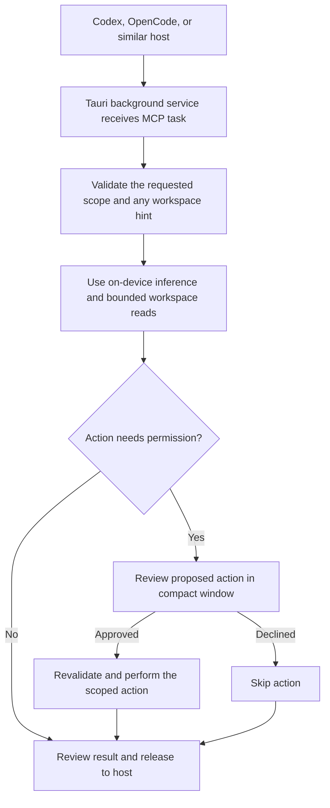

# AI-Worker desktop roadmap

Tauri is the target desktop host. Keep Electron runnable as the current product until Tauri reaches feature parity, passes installed host end-to-end checks, and can import all required user data through a versioned, backed-up, restart-safe migration with a tested rollback. Ship macOS first and verify Windows on its own hardware.

Keep the AI-Worker homepage and its user-visible integrations during the migration, including chat, settings and MCP connections, voice, browser workflows, memory, and WhatsApp. Add a compact task and review window that opens only for an external-agent task or approval. The service stays available in the background when windows close.

## Task flow

- Accept a bounded task summary, constraints, source agent, active or selected workspace root, working directory when known, and relevant relative file paths. Validate these as hints. Native policy controls OS access. When a task needs workspace access and the host root is missing or unreliable, ask the user to choose one.
- Allow bounded reads and searches inside the validated workspace by default. Review exact file changes and other side effects before execution. Revalidate approval against the current task, scope, and proposal. Let the user review what returns to the external host and release it explicitly.
- Use on-device inference for delegated work in Local-only and Connected modes. Local-only must never fall back to cloud. Reuse installed WebLLM or loopback Ollama where compatible. Keep public web research and connected services separately scoped and disclosed in Connected mode. Use only operations already supported by live connections.
- Keep the operation journal standalone for future write recovery. Claim journal-backed recovery only after desktop host integration and crash tests pass. [Journal integration cards](./operation-journal-integration.md)

## Stages and acceptance gates

| Stage | Work and gate |
| --- | --- |
| 1. Tauri host, lifecycle, and discovery | Establish a discoverable local MCP service and carry it across normal window open and close. Verify duplicate launch, idle operation, restart, and explicit quit. Clean up owned processes and discovery state. |
| 2. On-device status and inference | Expose truthful app and model readiness. Verify a real response, cancellation, and the next request with WebLLM or installed Ollama on the target platform. A missing model prompts setup and never triggers cloud fallback. Consider the unfinished `llama-server` candidate only after measured compatibility, cancellation, and resource checks. |
| 3. Host handoff and workspace reads | Pass bounded context into native validation. Verify correct worktree and relative-file handling, user selection for an unreliable root, rejection of workspace escapes, and read and search limits. |
| 4. Compact review, writes, and result release | Show request context, exact changes, and separately scoped web or service permissions. Verify rejection, cancellation, expired or stale approvals, and withheld results. Apply only the approved action and return the result only after release. Keep interrupted writes out of automatic replay. |
| 5. Homepage parity and user data | Verify existing homepage workflows and integrations on Tauri. Validate import, restart, repeat import, interrupted import, and rollback using representative Electron profiles. Keep Electron and the original profiles usable throughout. |
| 6. Installed hosts and packaging | Run installed Codex and OpenCode against packaged Tauri builds on each supported platform. Verify background discovery, local inference, bounded reads, write review, result release, update, and rollback. Record platform and WebView evidence. |
| 7. Electron retirement | Remove Electron only after stages 1–6 pass, feature parity is demonstrated, and all required data can be safely imported and rolled back. Preserve user backups and the supported migration path. |

## User-data migration

Electron and Tauri have different app IDs and storage origins. Export logical records from Electron and validate them before Tauri import. Never copy Chromium LevelDB directly. Back up both sides before applying changes. Keep a versioned import record so restarts and retries cannot duplicate or silently drop data.

- Preserve chat and history, non-secret settings and MCP configuration, memory JSONL and SQLite records, and per-workspace task state. Decide explicitly which drafts, logs, and browser profile data to import or retain in backup. Pending drafts stay unapproved.
- Keep OS-protected secrets, workspace grants, approvals, and ephemeral MCP tokens out of automatic migration. Require reauthorization or credential entry in Tauri. Decide how to preserve WhatsApp pairing continuity through an explicit secure transfer or re-pair flow.
- Verify complete memory export with only part of the cache loaded. Fix the SQLite migration's restart safety and verify interruption, repeat import, and rollback before cutover. [M08 export](./luna-implementation-cards.md#m08--add-a-versioned-legacy-electron-export) · [M09 import](./luna-implementation-cards.md#m09--importexport-safely-in-tauri) · [M37 rollback](./luna-implementation-cards.md#m37--prove-update-recovery-and-rollback) · [M39 retirement](./luna-implementation-cards.md#m39--remove-electron-production-and-build-paths)

## Current blockers

Electron contains the current homepage and local MCP handoff. Tauri's `LocalApp` is a draft and model-setup scaffold. Production Tauri still needs MCP host ingress, usable local inference, the task and approval window, homepage parity, and user-data migration. The isolated macOS WebView fixture proof is supporting evidence. A real model, installed-host workflows, and supported-platform packaging still need end-to-end verification. [Electron MCP bridge](../docs/AI_WORKER_READINESS_MCP.md) · [Migration baseline](./reports/migration-baseline.md) · [Stack proof](./reports/stack-proof.md)
